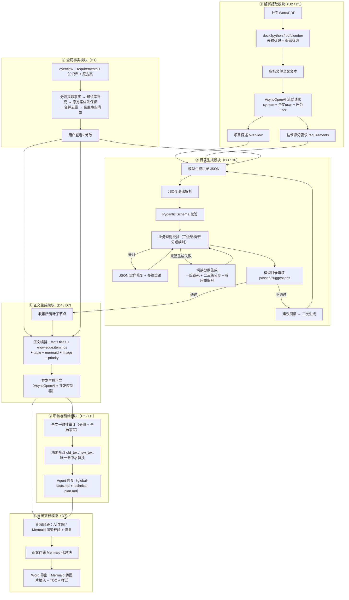
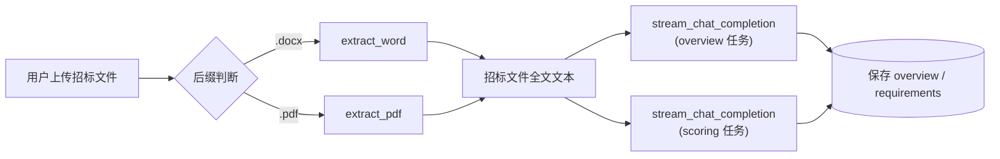
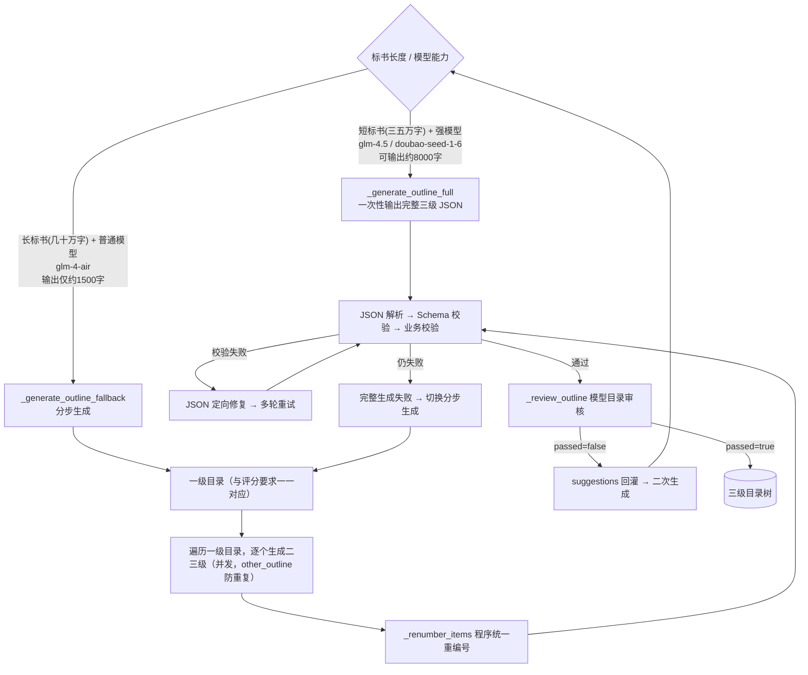
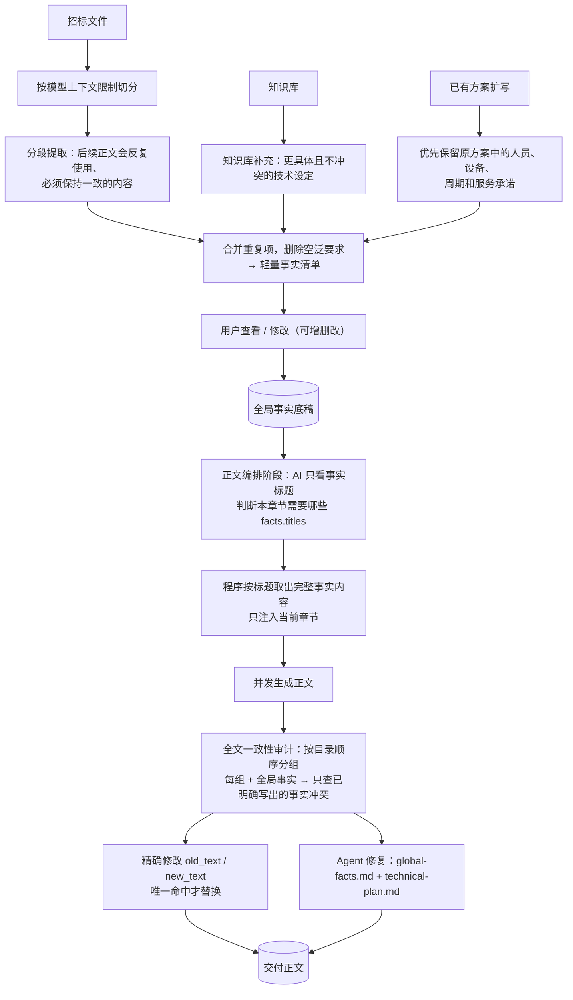
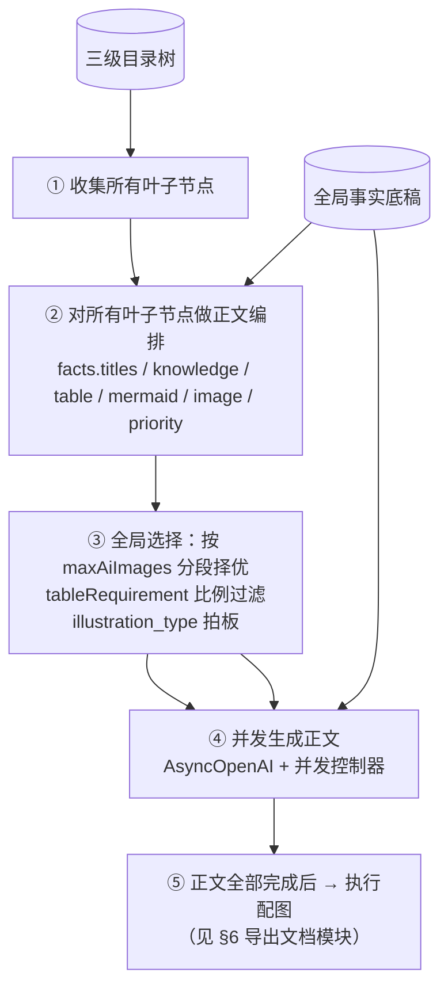
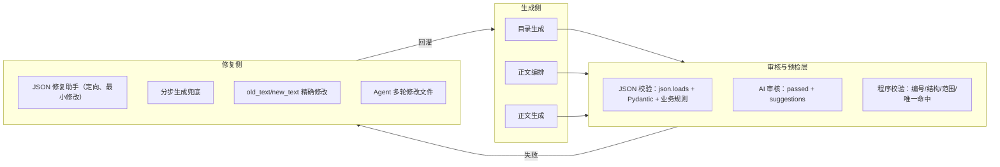
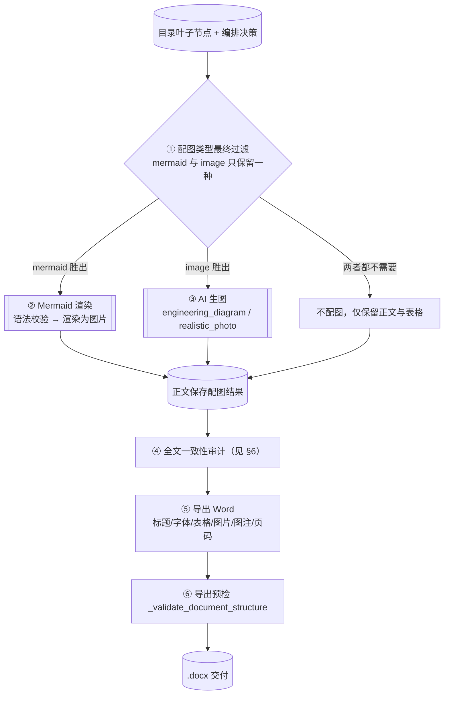

# 易标六模块全功能说明

> **目标**：把《OpenBidKit_Yibiao》9 篇开源文章的方案，完整对齐到本软件（`J:\编程\招投标方案平台`）的实现层，输出可直接编码的**工作流程 / 逻辑 / 提示词 / 数据结构 / 调用链路 / 容错机制**。
>
> **来源文档根目录**：`J:\编程\OpenBidKit 易标\OpenBidKit_Yibiao-main-2026-09-14\文章\`
> **开源代码**：https://github.com/FB208/OpenBidKit_Yibiao
>
> **本文标注约定**：`[据：<文档名>]` 表示该条结论的原文出处；`[代码：<相对路径>]` 表示本仓库已存在的落点。

---

## 0. 参考文档与结论依据清单

| 编号 | 文档 | 覆盖模块 |
| --- | --- | --- |
| D1 | 《AI生成标书，如何保证超长内容的全文一致性》 | 三、五 |
| D2 | 《标书智能体（一）——AI解析招标文件代码+提示词》 | 一 |
| D3 | 《标书智能体（二）——生成标书提纲代码+提示词》 | 二 |
| D4 | 《标书智能体（三）——生成标书正文代码+提示词》 | 四 |
| D5 | 《标书智能体（四）——提示词顺序优化，让缓存命中，输入成本直降10倍》 | 一、二、四、十 |
| D6 | 《标书智能体（五）——如何让弱模型也能稳定输出复杂json》 | 二、五 |
| D7 | 《标书智能体（六）——超长文本生成和图文控制》 | 四、六 |
| D8 | 《新系列一：关于AI知识库的一点拙见，非RAG》 | 七（横切） |
| D9 | 《新系列二：邪修 · 我在工作流里集成了opencode》 | 八（横切） |

> 说明：《标书智能体（七）——知识库之你不需要RAG》文件为 0 字节，其内容由 D8 承载。

---

## 1. 六模块工作流程全景图



**关键路径说明**（`[据：D1/D2/D3/D4/D5/D6/D7]`）

1. ①→② 串行：目录依赖 `overview` + `requirements` 两个解析结果。
2. ③ 与 ② 并行：全局事实在目录生成后即可启动，其产出在正文编排阶段才被消费（`[据：D1]` 第二步"每个章节只读取需要的事实"）。
3. ②→④ 有两条注入点：编排阶段（只给 `facts.titles`）与正文生成阶段（按标题取完整事实内容）。
4. ④→⑤→⑥ 严格串行：正文全部生成完才进入一致性审计与配图；配图失败不回滚正文（`[据：D7]`"配图失败，不应该影响正文结果"）。

---

---

## 2. 模块一：解析提取模块

**对应文档**：D2（主体）、D5（提示词顺序优化改造）

### 2.1 功能清单

| # | 功能 | 说明 | 依据 |
| --- | --- | --- | --- |
| 1.1 | Word 内容提取 | `docx2python`，表格与结构，表格标记 `[表格内容]` / `[表格结束]` | D2 一 |
| 1.2 | PDF 内容提取 | `pdfplumber`，按页提取 + `--- 第 N 页 ---` 页码标识，表格标记 `[表格 N]` / `[表格结束]` | D2 一 |
| 1.3 | 资源强制释放 | `del content` / `gc.collect()` / `pdf.close()`，异常分支同样执行 | D2 一 |
| 1.4 | AI 流式请求封装 | `AsyncOpenAI` 异步客户端 + `stream_chat_completion`，支持并发 | D2 二 |
| 1.5 | 项目概述提取 | 7 项关注点 + 3 条工作要求，只取实施内容，不取商务信息 | D2 三 |
| 1.6 | 技术评分要求提取 | 自我反思式结构化提示词，5 段结构（目标定位/提取内容/处理规则/输出示例/验证步骤） | D2 三 |
| 1.7 | 提示词顺序优化 | 三段消息 `system → 全文user → 任务user`，缓存命中降成本约 10 倍 | D5 二/六 |

### 2.2 工作流程



### 2.3 核心逻辑与实现方案

**① Word 提取**（`[代码：backend/app/services/docx_extractor.py]` 已实现 `extract_docx_docx2python` / `extract_docx_plain` / `is_docx2python_available`）

```python
# Word 提取：docx2python 能更好地处理表格和结构 [据：D2 一]
import gc
from docx2python import docx2python

def extract_word(file_path: str) -> str:
    content = None
    try:
        content = docx2python(file_path)
        extracted_text = []
        if hasattr(content, "document"):
            for section in content.document:
                for element in section:
                    if isinstance(element, list):
                        # 这可能是表格
                        extracted_text.append("\n[表格内容]")
                        for row in element:
                            if isinstance(row, list):
                                row_text = " | ".join(
                                    str(cell).strip() for cell in row if cell
                                )
                                if row_text:
                                    extracted_text.append(row_text)
                            else:
                                extracted_text.append(str(row))
                        extracted_text.append("[表格结束]\n")
                    else:
                        text = str(element).strip()
                        if text:
                            extracted_text.append(text)
        result = "\n".join(extracted_text).strip()
        if content:            # 确保释放资源 [据：D2 一]
            del content
        gc.collect()
        return result
    except Exception:
        if content:            # 异常分支同样释放
            del content
        gc.collect()
        raise
```

**② PDF 提取**

```python
# PDF 提取：pdfplumber 按页 + 页码标识 + 表格 [据：D2 一]
import gc
import pdfplumber

def extract_pdf(file_path: str) -> str:
    pdf = None
    try:
        extracted_text = []
        pdf = pdfplumber.open(file_path)
        for page_num, page in enumerate(pdf.pages, 1):
            extracted_text.append(f"\n--- 第 {page_num} 页 ---\n")  # 添加页码标识
            text = page.extract_text()
            if text:
                extracted_text.append(text)
            for table_num, table in enumerate(page.extract_tables(), 1):
                extracted_text.append(f"\n[表格 {table_num}]")
                for row in table:
                    if row:  # 跳过空行
                        row_text = " | ".join(str(c) if c else "" for c in row)
                        extracted_text.append(row_text)
                extracted_text.append("[表格结束]\n")
        result = "\n".join(extracted_text).strip()
        if pdf:
            pdf.close()        # 确保关闭PDF文件
        gc.collect()
        return result
    except Exception:
        if pdf:
            pdf.close()
        gc.collect()
        raise
```

> **落点说明**：`services/ocr_parser.py` 承担扫描件 OCR 补路。表格标记与页码标识是本模块的**契约**，下游（全局事实分段、知识库切 block）都依赖这些标记定位原文，**不得随意修改标记文本**。

**③ AI 流式请求封装**（`[代码：backend/app/services/ai/providers/openai_compatible.py]`）

```python
# 必须用 AsyncOpenAI：一次性编写几十万字标书需要并发请求 [据：D2 二]
from openai import AsyncOpenAI

class AIProvider:
    def __init__(self, api_key: str, base_url: str = None, model_name: str = "gpt-3.5-turbo"):
        self.api_key = api_key
        self.base_url = base_url
        self.model_name = model_name
        self.client = AsyncOpenAI(api_key=api_key, base_url=base_url if base_url else None)

    async def stream_chat_completion(self, messages: list, temperature: float = 0.7,
                                     response_format: dict = None):
        """流式聊天完成请求 - 真正的异步实现 [据：D2 二]"""
        try:
            stream = await self.client.chat.completions.create(
                model=self.model_name,
                messages=messages,
                temperature=temperature,
                stream=True,
                # response_format 可选注入，用于 JSON 模式
                **({"response_format": response_format} if response_format is not None else {}),
            )
            async for chunk in stream:
                if chunk.choices[0].delta.content is not None:
                    yield chunk.choices[0].delta.content
        except Exception as e:
            yield f"错误: {str(e)}"   # 错误处理：异常时 yield 错误信息
```

> **落点说明**：本仓库在 provider 之上封装了 `services/ai/workflows_base.py` 的并发治理四件套：`AIRequestMonitor`（L285）、`DynamicSemaphore`（L363）、`AdaptiveConcurrencyController`（L461）、`_get_global_ai_semaphore`（L618）、`_AnalysisCircuitBreaker`（L219）。这正是 D2"必须用 AsyncOpenAI"在工程上的落点——并发 + 动态限流 + 熔断。

### 2.4 提示词

**① 项目概述提取**（`[代码：backend/app/services/ai/prompts/analysis.py]`）

SystemPrompt `[据：D2 三 / 项目概述]`：

```markdown
你是一个专业的标书撰写专家。请分析用户发来的招标文件，提取并总结项目概述信息。

请重点关注以下方面：
1. 项目名称和基本信息
2. 项目背景和目的
3. 项目规模和预算
4. 项目时间安排
5. 项目要实施的具体内容
6. 主要技术特点
7. 其他关键要求

工作要求：
1. 保持提取信息的全面性和准确性，尽量使用原文内容，不要自己编写
2. 只关注与项目实施有关的内容，不提取商务信息
3. 直接返回整理好的项目概述，除此之外不返回任何其他内容
```

UserPrompt `[据：D2 三]`：

```markdown
请分析以下招标文件内容，提取项目概述信息：
{request.file_content}
```

**② 技术评分要求提取**（自我反思式结构化提示词）

> 设计意图 `[据：D2 三]`："在编写招标文件中的技术方案时，技术评分要求非常重要，基本要做到 1 对 1 应答式编写，所以评分要求的提取则尤为重要"。

SystemPrompt `[据：D2 三 / 技术评分要求]`：

```markdown
你是一名专业的招标文件分析师，擅长从复杂的招标文档中高效提取"技术评分项"相关内容。请严格按照以下步骤和规则执行任务：

### 1. 目标定位
- 重点识别文档中与"技术评分"、"评标方法"、"评分标准"、"技术参数"、"技术要求"、"技术方案"、"技术部分"或"评审要素"相关的章节（如"第X章 评标方法"或"附件X：技术评分表"）。
- 忽略商务、价格、资质等非技术类评分项。

### 2. 提取内容要求
对每一项技术评分项，按以下结构化格式输出（若信息缺失，标注"未提及"），如果评分项不够明确，你需要根据上下文分析并也整理成如下格式：
【评分项名称】：<原文描述，保留专业术语>
【权重/分值】：<具体分值或占比，如"30分"或"40%">
【评分标准】：<详细规则，如"≥95%得满分，每低1%扣0.5分">
【数据来源】：<文档中的位置，如"第5.2.3条"或"附件3-表2">

### 3. 处理规则
- **模糊表述**：有些招标文件格式不是很标准，没有明确的"技术评分表"，但一定都会有"技术评分"相关内容，请根据上下文判断评分项。
- **表格处理**：若评分项以表格形式呈现，按行提取，并标注"[表格数据]"。
- **分层结构**：若存在二级评分项（如"技术方案→子项1、子项2"），用缩进或编号体现层级关系。
- **单位统一**：将所有分值统一为"分"或"%"，并注明原文单位（如原文为"20点"则标注"[原文：20点]"）。

### 4. 输出示例
【评分项名称】：系统可用性
【权重/分值】：25分
【评分标准】：年平均故障时间≤1小时得满分；每增加1小时扣2分，最高扣10分。
【数据来源】：附件4-技术评分细则（第3页）

【评分项名称】：响应时间
【权重/分值】：15分 [原文：15%]
【评分标准】：≤50ms得满分；每增加10ms扣1分。
【数据来源】：第6.1.2条

### 5. 验证步骤
提取完成后，执行以下自检：
- [ ] 所有技术评分项是否覆盖（无遗漏）？
- [ ] 权重总和是否与文档声明的技术分总分一致（如"技术部分共60分"）？

直接返回提取结果，除此之外不输出任何其他内容
```

UserPrompt `[据：D2 三]`：

```markdown
请分析以下招标文件内容，提取技术评分要求信息：
{request.file_content}
```

> 可复用模式：① 目标定位白名单 + 黑名单；② 固定结构化字段；③ 模糊/表格/分层/单位四类边界规则；④ 自检清单。

### 2.5 数据结构

```python
# 解析结果对象（模块间契约）
class TenderAnalysisResult(BaseModel):
    file_content: str          # 招标文件全文（含表格/页码标记）
    overview: str              # 项目概述（纯文本，非 JSON）
    requirements: str          # 技术评分要求（【字段】结构化文本）
```

> 注意：D2 的两个解析结果都是**结构化文本**而非 JSON——因为它们要作为正文生成的稳定长前缀反复复用（见 §10 缓存优化）。转 JSON 的动作发生在目录生成模块的"一一对应模式"（§4.5）。

### 2.6 调用链路

```
前端上传 → POST /files                       routers/files.py
        → 落盘 + MIME 校验                    services/files.py
        → extract_docx_docx2python() / PDF 提取  services/docx_extractor.py
        → POST /ai/analyze                    routers/ai.py
        → 工作流调度                            services/ai/workflows_analysis.py
        → 构建消息                              services/ai/prompts/analysis.py
        → 流式请求 + 并发治理                   services/ai/providers/openai_compatible.py
                                                services/ai/workflows_base.py
        → SSE 增量回推                          routers/sse_handlers.py / sse_utils.py
        → 保存 overview / requirements          项目表
```

### 2.7 容错机制

| 风险 | 机制 | 依据 |
| --- | --- | --- |
| 文档损坏/加密 | `try/except` 捕获后仍执行资源释放，向上抛原始异常 | D2 一 |
| 内存泄漏（大 PDF） | `del content` + `gc.collect()` + `pdf.close()`，正常与异常双分支 | D2 一 |
| 表格提取为空 | 跳过空行；空行文本不追加 | D2 一 |
| AI 请求失败 | `stream_chat_completion` 异常时 `yield "错误: {str(e)}"`，让 SSE 前端可见 | D2 二 |
| 并发打爆服务商 | `_AnalysisCircuitBreaker`(threshold=2, cooldown=5s) + `DynamicSemaphore` + `AdaptiveConcurrencyController` | `[代码：workflows_base.py]` |
| 缓存不吃 | 三段消息结构（§10），避免 `system_prompt` / `user_prompt` 前缀变化 | D5 一 |
| 服务商不支持 `response_format` | 降级为普通请求后自行解析 JSON（见 §5.4） | D6 三 |

### 2.8 落地建议

1. **优先复用** `services/docx_extractor.py` 现有双实现，无需重写；仅需核对表格标记是否为 `[表格内容]/[表格结束]`、`[表格 N]/[表格结束]`。这些标记是全局事实分段、知识库 `_step_build_blocks` 的切分契约，**不得随意修改**。
2. `prompts/analysis.py` 需按 §2.4 补齐"**验证步骤**"两段（覆盖性 + 权重总和自检）——这是 D2 里唯一最容易被摘要掉但价值最高的部分。
3. `services/ai/prompts/_cache.py` 已有缓存前缀治理设施，建议在 `workflows_analysis.py` 中显式声明"招标文件全文必须为第 2 条消息"，与 §10 对齐。

---

## 3. 模块二：目录生成模块

**对应文档**：D3（主流程 + check_json）、D6（弱模型稳定 JSON 的完整工程化）、D5（缓存分层消息）

### 3.1 功能清单

| # | 功能 | 说明 | 依据 |
| --- | --- | --- | --- |
| 2.1 | 三个难点识别 | 格式化输出、超出 AI 输出长度、提纲可编辑 | D3 开头 |
| 2.2 | 短标书 + 强模型 | 一次性输出完整三级 JSON 目录 | D3 一 |
| 2.3 | 长标书 + 普通模型 | 一级目录锁对应 → 遍历生成二三级 → 校验 → 拼装 | D3 二 |
| 2.4 | 弱模型稳定 JSON | 9 步自我反思/矫正闭环 | D6 一/九 |
| 2.5 | Pydantic 标准结构 | `OutlineItem` / `OutlineResponse` / `OutlineChildrenResponse` / `OutlineReviewResponse` | D6 二 |
| 2.6 | 统一 JSON 生成封装 | `collect_json_response` 八步 + JSON 模式降级 | D6 三 |
| 2.7 | 失败后定向修复 | 最小必要修改 + 具体错误信息回喂 | D6 四/五 |
| 2.8 | 完整失败切分步 | `_generate_outline_full` → `_generate_outline_fallback` | D6 六 |
| 2.9 | 程序统一重编号 | `_renumber_items`，不信任模型编号 | D6 六 |
| 2.10 | 目录审核 | 模型审核自身输出，`{passed, suggestions}` | D6 七 |
| 2.11 | 建议回灌二次生成 | 审核不通过则带建议重新生成 | D6 七 |
| 2.12 | 一一对应模式 | 程序构造一级目录并锁死，模型只生成二三级 | D6 八 |
| 2.13 | JSON 结构校验 | `check_json` 按模板递归校验 + 3 次重试 | D3 二 |

### 3.2 工作流程

**三个难点** `[据：D3 开头]`

- **格式化输出**：为了生成正文时 AI 能很好理解提纲、保证结构不错乱，提纲必须是格式化的。
- **超出 AI 输出长度**：几十万字的标书提纲不会短，AI 实际输出也就 2 千字左右，无法直接输出完整长提纲。
- **提纲可编辑**：AI 生成的提纲没法 100% 满足要求，提纲必须可编辑，且**编辑后不能破坏原有结构**。

**双方案分流**：



> **落点说明**：`[代码：backend/app/services/ai/workflows_outline_v51.py]`（197KB）为主实现，`workflows_outline_utils.py`（64KB）承载全部校验与修复工具函数。

### 3.3 数据结构

**① JSON 目录结构** `[据：D3 一 / JSON结构]`

```json
{
  "outline": [
    {
      "id": "1",
      "title": "",
      "description": "",
      "children": [
        {
          "id": "1.1",
          "title": "",
          "description": "",
          "children": [
            { "id": "1.1.1", "title": "", "description": "" }
          ]
        }
      ]
    }
  ]
}
```

**② Pydantic 标准定义** `[据：D6 二]`

```python
from typing import Optional, List
from pydantic import BaseModel, Field

class OutlineItem(BaseModel):
    """目录项"""
    id: str
    title: str
    description: str
    source_requirement_id: Optional[str] = None      # 关联技术评分项
    source_requirement_title: Optional[str] = None
    children: Optional[List["OutlineItem"]] = None    # 递归子目录
    content: Optional[str] = None                     # 后续挂载正文

class OutlineResponse(BaseModel):
    """完整目录响应"""
    outline: List[OutlineItem]

class OutlineChildrenResponse(BaseModel):
    """指定一级目录下的子目录响应（分步生成用）"""
    children: List[OutlineItem]

class OutlineReviewResponse(BaseModel):
    """目录审核响应"""
    passed: bool
    suggestions: List[str] = Field(default_factory=list)
```

> **落点说明**：本仓库目录树落点为 `[代码：services/ai/workflows_outline_utils.py]`：`_flatten_outline_tree`(L223)、`_renumber_items`(L249)、`normalize_outline_items`(L274)、`_strip_title_number_prefix`(L380)、`_dedupe_outline_titles`(L395)、`validate_outline_business`(L436)、`semantic_relevance_check`(L612)、`validate_outline_with_semantic`(L667)、`validate_l3_specificity`(L722)、`_repair_one`(L836)。

**③ 业务校验：合法 JSON ≠ 可用 JSON** `[据：D6 二]`

> 关键认知：模型可以返回完全合法的 JSON，但对标书无用。例如只有一级目录的返回是合法 JSON，却不满足三级结构要求。

```python
@classmethod
def _validate_complete_outline(cls, payload: Dict[str, Any]) -> None:
    """校验完整目录至少达到三级结构。"""
    outline = payload.get("outline") or []
    if not outline:
        raise ValueError("目录不能为空")

    if cls._outline_depth(outline) < 3:
        raise ValueError("完整目录至少需要三级结构")
```

### 3.4 提示词

**① 短标书 + 强模型：一次性完整目录**

SystemPrompt `[据：D3 一 / 提示词]`：

```markdown
你是一个专业的标书编写专家。根据提供的项目概述和技术评分要求，生成投标文件中技术标部分的目录结构。

要求：
1. 目录结构要全面覆盖技术标的所有必要章节
2. 章节名称要专业、准确，符合投标文件规范
3. 一级目录名称要与技术评分要求中的章节名称一致，如果技术评分要求中没有章节名称，则结合技术评分要求中的内容，生成一级目录名称
4. 一共包括三级目录
5. 返回标准JSON格式，包含章节编号、标题、描述和子章节
6. 除了JSON结果外，不要输出任何其他内容

JSON格式要求：
{
  "outline": [
    {
      "id": "1",
      "title": "",
      "description": "",
      "children": [
        {
          "id": "1.1",
          "title": "",
          "description": "",
          "children":[
              {
                "id": "1.1.1",
                "title": "",
                "description": ""
              }
          ]
        }
      ]
    }
  ]
}
```

UserPrompt `[据：D3 一]`：

```markdown
请基于以下项目信息生成标书目录结构：

项目概述：
{overview}

技术评分要求：
{requirements}

请生成完整的技术标目录结构，确保覆盖所有技术评分要点。
```

**② 长标书 + 普通模型**

> 限制 `[据：D3 二]`：上下文短，仅能输出 1500 字左右；输出结果不稳定，尤其是 JSON 这类结构化数据可能出现格式错误。
> 思路 `[据：D3 二]`：① 先生成一级目录（要与技术评分要求一一对应）；② 遍历一级目录逐个生成二、三级目录（多个 AI 任务并发，保证不重复）；③ 校验 JSON 格式；④ 拼成完整目录。**这种生成工作流理论上可以生成无限长度的提纲。**

**A. 生成一级标题**

SystemPrompt `[据：D3 二 / 生成一级标题]`：

```markdown
### 角色
你是专业的标书编写专家，擅长根据项目需求编写标书。

### 人物
1. 根据得到的项目概述(overview)和评分要求(requirements)，撰写技术标部分的一级提纲

### 说明
2. 只设计一级标题，数量要和"评分要求"一一对应
3. 一级标题名称要进行简单修改，不能完全使用"评分要求"中的文字

### Output Format in JSON
{
	"rating_item":"原评分项",
	"new_title":"根据评分项修改的标题"
}
```

UserPrompt `[据：D3 二]`：

```markdown
### 项目信息

<overview>
{overview}
</overview>

<requirements>
{requirements}
</requirements>


直接返回json，不要任何额外说明或格式标记
```

**B. 拼接 JSON 框架（不让 AI 处理 JSON 结构）**

> 关键设计 `[据：D3 二 / 生成二级标题]`："为了生成结果稳定，我们**不让 AI 来处理 JSON 框架，而是提前用代码拼接好 JSON 框架，仅让 AI 在 JSON 框架中填写内容**。"

```python
# 拼接 json 框架：编号、层级结构全部由程序生成 [据：D3 二]
def generate_one_outline_json_by_level1(level1_title: str, level1_index: int, nodes_distribution: Dict) -> Dict:
    # 获取当前一级节点下的二级节点数量和叶子节点分配
    level2_count = nodes_distribution['level2_nodes'][level1_index - 1]
    leaf_distribution = nodes_distribution['leaf_per_level2'][level1_index - 1]

    # 创建一级节点
    level1_node = {
        "id": f"{level1_index}",
        "title": level1_title,
        "description": "",
        "children": []
    }

    # 创建二级节点
    for j in range(level2_count):
        level2_node = {
            "id": f"{level1_index}.{j+1}",
            "title": "",      # 二级标题留空
            "description": "",
            "children": []
        }
        # 创建三级节点（叶子节点）
        leaf_count = leaf_distribution[j]
        for k in range(leaf_count):
            level2_node["children"].append({
                "id": f"{level1_index}.{j+1}.{k+1}",
                "title": "",   # 三级标题留空
                "description": ""
            })
        level1_node["children"].append(level2_node)

    return level1_node
```

> `nodes_distribution` 用于让二三级目录数量不一致，随机指定两个重点章节，更贴近真实标书结构（`[据：D3 二]`）。

**C. 防重复：other_outline**

```python
# 拼接其他章节的标题传给 AI 参考，以免生成重复的章节内容 [据：D3 二]
other_outline = "\n".join([f"{j+1}. {node['new_title']}"
                           for j, node in enumerate(level_l1)
                           if j != i])
```

**D. 生成二级标题**

SystemPrompt `[据：D3 二 / 生成二级标题]`（`json_outline` 为上面拼好的框架）：

```markdown
### 角色
你是专业的标书编写专家，擅长根据项目需求编写标书。

### 任务
1. 根据得到项目概述(overview)、评分要求(requirements)补全标书的提纲的二三级目录

### 说明
2. 你将会得到一段json，这是提纲的其中一个章节，你需要再原结构上补全标题(title)和描述(description)
3. 二级标题根据一级标题撰写,三级标题根据二级标题撰写
4. 补全的内容要参考项目概述(overview)、评分要求(requirements)等项目信息
5. 你还会收到其他章节的标题(other_outline)，你需要确保本章节的内容不会包含其他章节的内容

### 注意事项
在原json上补全信息，禁止修改json结构，禁止修改一级标题

### Output Format in JSON
{json_outline}
```

UserPrompt `[据：D3 二]`：

```markdown
### 项目信息

<overview>
{overview}
</overview>

<requirements>
{requirements}
</requirements>

<other_outline>
{other_outline}
</other_outline>


直接返回json，不要任何额外说明或格式标记
```

### 3.5 JSON 校验与修复机制

**① `check_json`：按模板递归校验结构与类型** `[据：D3 二 / 校验生成json结果是否和传入框架一致]`

```python
import json

def check_json(json_str: str, schema: str | dict) -> tuple[bool, str]:
    """
    根据模板 JSON 校验目标字符串的格式是否符合要求

    Args:
        json_str: 要校验的 JSON 字符串
        schema: 模板 JSON 字符串或字典对象，用于定义预期的数据结构

    Returns:
        tuple[bool, str]: (是否验证通过, 错误信息)
        如果验证通过返回 (True, "")，否则返回 (False, 错误原因)
    """
    try:
        # 解析输入的 JSON 字符串
        try:
            data = json.loads(json_str)
        except json.JSONDecodeError as e:
            return False, f"JSON 解析错误: {str(e)}"

        # 处理 schema 参数
        try:
            if isinstance(schema, str):
                schema = json.loads(schema)
            elif not isinstance(schema, dict):
                return False, "schema 必须是 JSON 字符串或字典对象"
        except json.JSONDecodeError as e:
            return False, f"schema 解析错误: {str(e)}"

        def check_structure(target, template, path=""):
            # 处理数字类型（int 和 float 可以互换）
            if isinstance(template, (int, float)) and isinstance(target, (int, float)):
                return True, ""

            # 检查基本数据类型
            if type(template) != type(target) and not (
                isinstance(template, (int, float)) and isinstance(target, (int, float))
            ):
                return False, (
                    f"路径 '{path}' 的类型不匹配: "
                    f"期望 {type(template).__name__}, 实际 {type(target).__name__}"
                )

            # 如果是列表类型
            if isinstance(template, list):
                if not template:      # 模板列表为空，则允许任何列表
                    return True, ""
                if not target:         # 目标列表为空，但模板不为空
                    return False, f"路径 '{path}' 的列表为空，但期望有内容"

                # 检查列表中的每个元素是否符合模板中第一个元素的格式
                template_item = template[0]
                for i, item in enumerate(target):
                    is_valid, error = check_structure(item, template_item, f"{path}[{i}]")
                    if not is_valid:
                        return False, error
                return True, ""

            # 如果是字典类型
            elif isinstance(template, dict):
                # 检查所有必需的键是否存在，并且值的类型是否正确
                for key in template:
                    if key not in target:
                        return False, f"路径 '{path}' 缺少必需的键 '{key}'"
                    is_valid, error = check_structure(target[key], template[key], f"{path}.{key}")
                    if not is_valid:
                        return False, error
                return True, ""

            # 对于其他基本类型，返回 True
            return True, ""

        is_valid, error = check_structure(data, schema)
        return is_valid, error if not is_valid else ""

    except Exception as e:
        return False, f"未预期的错误: {str(e)}"
```

> **重试策略** `[据：D3 二]`："在执行过程中，设置 **3 次重试**，如果校验没通过，再重新执行一次，以保证成功率"。

**② `collect_json_response`：全项目统一的 JSON 生成入口** `[据：D6 三]`

> 项目里所有需要 JSON 输出的地方，都会走同一个函数。它做 8 件事：① 请求模型；② 优先使用 JSON 模式；③ 模型不支持 `response_format` 时自动切换普通请求；④ 提取模型返回中的 JSON；⑤ 用 Pydantic 校验；⑥ 执行业务校验；⑦ 失败后进入 JSON 修复流程；⑧ 连续失败后再抛出错误。

```python
async def collect_json_response(
    self,
    messages: list[dict[str, str]],
    temperature: float = 0.7,
    schema: type[BaseModel] | None = None,
    validator: JsonValidator | None = None,
    progress_callback: ProgressCallback | None = None,
    progress_label: str = "JSON结果",
    failure_message: str = "模型返回的 JSON 数据格式无效",
) -> Dict[str, Any]:
    """收集并校验 JSON 响应。"""
```

JSON 模式请求 `[据：D6 三]`：

```python
content = await self.collect_chat_completion(
    messages,
    temperature=temperature,
    response_format={"type": "json_object"} if use_response_format else None,
)
```

**JSON 模式不支持时的降级** `[据：D6 三]`：

> 很多 OpenAI-like 服务并不完全支持 `response_format`。所以系统**没有把稳定性绑定在 JSON 模式上**，而是做了兼容处理。这里是"降级"，但不是功能降级，而是兼容不同模型接口。

```python
except AppError as exc:
    if (
        not use_response_format
        or not self._is_response_format_unsupported_error(exc.message)
    ):
        raise

    await self.emit_progress(
        progress_callback,
        "当前模型不支持结构化 JSON 响应，已降级为普通请求解析。",
    )
    content = await self.collect_chat_completion(
        messages,
        temperature=temperature,
        response_format=None,
    )
    return content, False
```

> **落点说明**：本仓库 `[代码：workflows_base.py]` 已有 `_trim_json_mode_unsupported`(L778)、`_provider_json_mode_key`(L787)，用于记录"某服务商不支持 JSON 模式"并跨请求复用该判断。

**③ 失败后定向修复：不推倒重来** `[据：D6 四]`

> 设计动机：模型返回的 JSON 校验失败时，系统不会立刻重来。因为很多时候模型已经生成了大部分正确内容，只是某个字段错了，或者外面多了一层代码块。这时候**推倒重来很浪费，而且新结果也未必更好**。

JSON 修复助手 SystemPrompt `[据：D6 四]`：

```markdown
你是一个严格的 JSON 修复助手。请根据给出的原始内容和校验问题，修复现有结果。

要求：
1. 优先在原结果基础上做最小必要修改，不要整体重写
2. 尽量保留原有结构、字段值、节点顺序和已生成内容
3. 若缺少必填字段，应结合现有上下文补齐合理内容，不要用空字符串敷衍
4. 若存在多余说明、代码块包裹、字段名错误、children 结构不规范或顶层包裹错误，应修正为合法 JSON
5. 只返回修复后的完整 JSON，不要输出任何解释
```

修复时传入三部分信息：

```python
# 修复时把三部分信息传给模型：目标结果类型、校验问题、原始内容
repair_messages = build_json_repair_messages(
    invalid_content=invalid_content,   # 模型刚才返回的原始内容
    issues=issues,                     # 当前校验问题
    target_description=progress_label, # 目标结果类型，如"完整目录""章节子目录"
)
```

> **落点说明**：`[代码：backend/app/services/ai/prompts/json_repair.py]`（5.6KB）承载 `build_json_repair_messages`；`workflows_outline_utils.py::_repair_one`(L836) 为目录场景的修复入口。

**④ 校验问题必须明确告诉模型** `[据：D6 五]`

```python
@staticmethod
def _format_json_issues(error: Exception) -> list[str]:
    """格式化 JSON 解析或校验问题。"""
    if isinstance(error, json.JSONDecodeError):
        return [
            f"JSON 语法错误：第 {error.lineno} 行第 {error.colno} 列附近 {error.msg}。"
        ]

    if isinstance(error, ValidationError):
        issues: list[str] = []
        for item in error.errors():
            location = ".".join(str(part) for part in item.get("loc", [])) or "root"
            message = item.get("msg", "字段校验失败")
            issues.append(f"{location}: {message}")
        return issues or [str(error)]

    return [str(error)]
```

> 效果：模型少了 `description` 字段时，修复助手拿到的不是"格式不对"，而是 `outline.0.children.1.description: Field required`。**模型知道具体哪里错，修复成功率自然更高**。

**⑤ 完整目录失败 → 切换分步生成** `[据：D6 六]`

```python
try:
    outline = await self._generate_outline_full(
        overview=overview,
        requirements=requirements,
        uploaded_expand=uploaded_expand,
        old_outline=old_outline,
        suggestions=suggestions,
        progress_callback=progress_callback,
    )
    return outline, "full"
except AppError as exc:
    if exc.message != "模型返回的目录数据格式无效":
        raise
    await self.ai.emit_progress(
        progress_callback,
        "一次性生成完整目录失败，切换为分步生成模式。",
    )
    outline = await self._generate_outline_fallback(
        overview=overview,
        requirements=requirements,
        uploaded_expand=uploaded_expand,
        old_outline=old_outline,
        suggestions=suggestions,
        progress_callback=progress_callback,
    )
    return outline, "fallback"
```

分步生成逻辑 `[据：D6 六]`：① 先生成一级目录；② 遍历每个一级目录；③ 单独生成这个一级目录下面的二三级目录；④ 把多个结果组装起来；⑤ 程序统一重新编号；⑥ 最后再做完整目录校验。

```python
top_level_outline = await self._generate_top_level_outline(...)
top_level_items = top_level_outline.get("outline", [])
assembled_items: list[dict[str, Any]] = []

for index, item in enumerate(top_level_items, start=1):
    children_response = await self._generate_outline_children(
        overview=overview,
        requirements=requirements,
        parent_item=item,
        uploaded_expand=uploaded_expand,
        old_outline=old_outline,
        suggestions=suggestions,
        progress_callback=progress_callback,
    )
    children = children_response.get("children") or []
    if children:
        merged_item["children"] = children
    assembled_items.append(merged_item)

outline = self._renumber_outline({"outline": assembled_items})
```

**⑥ 程序统一重编号：编号不要完全相信模型** `[据：D6 六]`

> 经过大量测试，**即使在提示词中告诉模型你生成的是第二章的目录，返回的编号仍然是从 `1` 开始的，甚至有可能乱编号**。所以最终用程序统一编号。"**能用代码保证的事情，就不要交给模型保证。**"

```python
@classmethod
def _renumber_items(
    cls,
    items: list[dict[str, Any]],
    parent_prefix: str = "",
) -> list[dict[str, Any]]:
    """递归重排目录项编号。"""
    normalized_items: list[dict[str, Any]] = []
    for index, item in enumerate(items, start=1):
        item_id = f"{parent_prefix}.{index}" if parent_prefix else str(index)
        normalized_item = {**item, "id": item_id}
        children = item.get("children") or []
        if children:
            normalized_item["children"] = cls._renumber_items(children, item_id)
        else:
            normalized_item.pop("children", None)   # 叶子节点移除空 children
        normalized_items.append(normalized_item)
    return normalized_items
```

### 3.6 目录审核与一一对应模式

**① 让模型审核自己生成的目录** `[据：D6 七]`

> JSON 格式正确，不代表目录质量正确。可能漏掉了某个评分项，或者一级目录没有和技术评分要求对应起来。

审核 SystemPrompt `[据：D6 七]`：

```markdown
你是一个严格的招标文件目录审核专家。请审核目录是否符合项目概述和技术评分要求。

要求：
1. 重点检查目录是否完整覆盖技术评分要点
2. 检查一级目录名称是否专业、准确，是否尽量与评分项原文保持一致
3. 检查目录层级是否清晰，是否达到三级目录要求，是否存在明显遗漏、错位、重复或不合理章节
4. 只返回 JSON，格式为：{"passed": true, "suggestions": []}
5. 若不通过，suggestions 中必须给出具体、可执行的修改建议
6. 除了 JSON 外，不要输出任何其他内容
```

审核结果结构 `[据：D6 七]`：

```json
{
  "passed": false,
  "suggestions": [
    "补充系统安全保障相关章节",
    "一级目录需要更贴近技术评分项名称"
  ]
}
```

主流程：审核不通过则把建议回灌给生成 Prompt，再重新生成 `[据：D6 七]`：

```python
first_outline, generation_mode = await self._generate_outline_by_mode(...)

first_review = await self._review_outline(
    overview=overview,
    requirements=requirements,
    outline=first_outline,
    progress_callback=progress_callback,
    stage_label="首次审核",
)

if first_review["passed"]:
    return first_outline

suggestions = first_review.get("suggestions") or [
    "请根据项目概述和技术评分要求补全目录覆盖范围，并修正不合理章节。"
]

second_outline, _ = await self._generate_outline_by_mode(
    overview=overview,
    requirements=requirements,
    uploaded_expand=uploaded_expand,
    old_outline=old_outline,
    mode=generation_mode,
    progress_callback=progress_callback,
    suggestions=suggestions,   # 建议回灌
)
```

**② 一一对应模式：把一级目录交给程序锁死** `[据：D6 八]`

> 原因：很多招标文件的技术评分要求非常明确，技术标目录最好和评分大类一一对应。如果把一级目录完全交给模型，它可能会合并、改写、漏掉某些评分大类。

流程 `[据：D6 八]`：① 先从技术评分要求中提取评分大类；② 程序根据评分大类直接构造一级目录；③ 一级目录标题、顺序、关联评分项都锁死；④ 模型只负责生成每个一级目录下的二三级目录；⑤ 最后再校验一级目录和评分大类是否完全一致。

提取评分大类 SystemPrompt `[据：D6 八]`：

```markdown
你是一个专业的招标文件分析专家。请从技术评分要求中提取适合作为技术标一级目录的评分大类。

要求：
1. 只提取技术评分大类，不要提取商务、报价、资质、售后服务等非技术类条目
2. 每个大类都必须适合作为技术标一级目录标题，标题要专业、简洁、完整
3. 同一大类下的细项、子项、分值说明、评分标准要归入 detail_points，不要拆成多个一级目录
4. requirement_id 必须唯一，使用 R1、R2、R3 这种格式
5. description 需要概括该大类关注的核心内容
6. detail_points 中保留该大类下的关键评分细项，使用简洁短句
7. 只返回 JSON，格式必须为 {"groups": [...]}，不要输出任何其他内容
```

程序构造一级目录 `[据：D6 八]`：

```python
@staticmethod
def _build_top_level_outline_from_groups(groups: list[dict[str, Any]]) -> list[dict[str, Any]]:
    """根据技术评分大类直接构造一级目录。"""
    outline: list[dict[str, Any]] = []
    for index, group in enumerate(groups, start=1):
        title = str(group.get("title") or "").strip()
        outline.append({
            "id": str(index),
            "title": title,
            "description": str(group.get("description") or title).strip(),
            "source_requirement_id": str(group.get("requirement_id") or f"R{index}").strip(),
            "source_requirement_title": title,
        })
    return outline
```

校验一级目录映射 `[据：D6 八]`：

```python
if len(outline_items) != len(groups):
    raise ValueError("一级目录数量必须与技术评分大类数量一致")

for index, (item, group) in enumerate(zip(outline_items, groups), start=1):
    expected_title = str(group.get("title") or "").strip()
    actual_title = str(item.get("title") or "").strip()
    if actual_title != expected_title:
        raise ValueError(
            f"第 {index} 个一级目录标题必须严格等于技术评分大类标题：{expected_title}"
        )
```

> 核心思想 `[据：D6 八]`：**不要让模型决定所有事情。能由程序确定的结构，就用程序确定。模型只负责它擅长的部分。**

### 3.7 弱模型 JSON 输出九条工程原则 `[据：D6 九]`

1. 提示词要明确，但不能只靠提示词。
2. 所有 JSON 输出必须走统一解析和校验。
3. 校验不只看语法，还要看业务规则。
4. 失败后优先修复已有结果，不要直接推倒重来。
5. 修复时要把具体错误原因告诉模型。
6. 大 JSON 生成失败，就拆成多个小 JSON。
7. 编号、映射关系这类确定性逻辑，尽量交给程序。
8. 生成后要审核，审核建议要能回流到下一轮生成。
9. 长流程要通过 SSE 告诉用户系统正在做什么。

> 一句话总结 `[据：D6 九]`：**弱模型不是不能用，而是不能裸用。** 只要加上校验、修复、重试、分步生成和自我审核，一样可以稳定完成复杂 JSON 输出。

### 3.8 调用链路

```
POST /ai/outline/generate            routers/sse_outline.py (55KB)
    → _generate_outline_by_mode(mode=full|step|mapping)
        ├─ _generate_outline_full        一次性三级 JSON
        └─ _generate_outline_fallback
            ├─ _generate_top_level_outline   （或 _build_top_level_outline_from_groups）
            ├─ _generate_outline_children ×N  并发
            └─ _renumber_outline / _renumber_items
    → collect_json_response(每次 JSON 输出统一入口)
        ├─ collect_chat_completion(response_format={"type":"json_object"})
        ├─ 不支持 → 降级普通请求
        ├─ 提取 JSON → Pydantic 校验 → validator 业务校验
        └─ 失败 → build_json_repair_messages → 修复 → 重试
    → _review_outline（_review_outline 模型审核）
        └─ passed=false → suggestions 回灌 → 二次生成
    → SSE 回推每一阶段（进度可见）
```

### 3.9 容错机制

| 风险 | 机制 | 依据 |
| --- | --- | --- |
| JSON 语法错误（少逗号/括号） | 统一 JSON 解析 → `_format_json_issues` 定位行列 → 定向修复 | D6 一/五 |
| 模型套 markdown 代码块 | 修复助手"多余说明、代码块包裹"规则 | D6 四 |
| 字段名错误（`children`→`child`） | Pydantic Schema 校验 + 错误定位 `loc` | D6 二/五 |
| 只生成两级目录 | `_validate_complete_outline` 三级深度业务校验 | D6 二 |
| 一级目录与评分项对不上 | 一一对应模式程序锁死 + 映射校验 | D6 八 |
| 分步生成编号混乱 | `_renumber_items` 程序统一重编号 | D6 六 |
| 服务商不支持 JSON 模式 | `_is_response_format_unsupported_error` 降级 | D6 三 |
| 完整生成反复失败 | `_generate_outline_full` 抛 `AppError` → 自动切 `_generate_outline_fallback` | D6 六 |
| 目录质量差 | `_review_outline` 审核 + suggestions 回灌二次生成 | D6 七 |
| 并发打爆 | `AIRequestMonitor` / `DynamicSemaphore` / `AdaptiveConcurrencyController` | `[代码：workflows_base.py]` |
| 3 次重试后仍失败 | `collect_json_response` 连续失败抛出明确错误 | D6 三 |

### 3.10 落地建议

1. **`_generate_outline_full` 与 `_generate_outline_fallback` 的异常契约必须严格**：只有 `exc.message == "模型返回的目录数据格式无效"` 才允许切分步；其他异常（网络、限流、鉴权）必须原样抛出，否则会掩盖真实故障 `[据：D6 六]`。
2. **`source_requirement_id` / `source_requirement_title` 两个字段必须落到数据库**：它们是一一对应模式的骨架，也是后续正文"应答式编写"的追溯依据。
3. **`validate_l3_specificity`（L722）值得接入审核链**：本仓库已实现三级标题项目特异性校验，可替代 D6 中"模型审核目录"的一部分主观判断，降低审核轮次成本。
4. **SSE 阶段文案要写全**：D6 九条原则第 9 条明确要求"长流程要通过 SSE 告诉用户系统正在做什么"，包括"一次性生成完整目录失败，切换为分步生成模式"这类切换事件。

---

## 4. 模块三：全局事实模块

**对应文档**：D1（全文一致性，主体）；数据消费点在 D7（正文编排）

### 4.1 功能清单

| # | 功能 | 说明 | 依据 |
| --- | --- | --- | --- |
| 3.1 | 问题定义 | 并发叶子节点相互独立导致工期/响应/人员/设备/质保前后不一致 | D1 一 |
| 3.2 | 排除长上下文方案 | 《Lost in the Middle》证明长上下文中间信息表现下降 | D1 二 |
| 3.3 | 排除摘要方案 | 摘要须串行、总结性质、无实质约束力 | D1 二 |
| 3.4 | 生成全局事实清单 | 分段提取 → 知识库补充 → 原方案优先保留 → 合并去重 | D1 三 |
| 3.5 | 用户可编辑 | 事实生成后先让用户查看和修改 | D1 三 |
| 3.6 | 编排阶段按需引用 | AI 只看到事实标题，按标题取出完整内容 | D1 四 |
| 3.7 | 正文硬约束 | 提供则必须使用，未提供不得编造人员/周期/质保/品牌/型号 | D1 四 |
| 3.8 | 生成后一致性审计 | 分组 + 全局事实 → 冲突检测 → 精确修改 | D1 五 |
| 3.9 | Agent 修复模式 | `global-facts.md` + `technical-plan.md`，搜索/索引/多轮修改 | D1 六 |
| 3.10 | 一致性边界声明 | 不能 100% 保证，需专业人员复核 | D1 七 |

### 4.2 工作流程



### 4.3 核心逻辑辨析（三方案排除 → 事实方案确立）

**① 问题** `[据：D1 一]`

> 把几十万甚至上百万字生成出来，其实不算最难。正文按目录叶子节点拆开，并发请求 AI 就行了。**真正难的是：每个章节单独看都没问题，合在一起却不像同一份标书。**
>
> - 实施方案写工期 90 天，进度计划变成 120 天
> - 售后方案承诺 2 小时响应，服务保障又写成 4 小时
> - 项目经理、人员数量、设备型号在不同章节反复变化
> - 前面写三年质保，后面突然只剩一年
>
> 这种错误比文字不够漂亮严重得多。**评标专家只要交叉看两章，就会怀疑整份方案是不是东拼西凑的。**

**② 排除长上下文** `[据：D1 二]`

> 很多人的第一反应是换一个上下文更大的模型，把招标文件和已生成正文全部塞进去。但**上下文能装下，不等于 AI 能稳定用到**。
> 《Lost in the Middle》论文专门测试过这个问题：**关键信息放在长上下文中间时，模型表现会明显下降**。上下文越长，关键事实反而越容易被大量无关内容淹没。
> 而且标书正文是分章节并发生成的，每个请求都只看当前章节，它们并不知道其他章节刚刚写了什么。所以只在提示词里写一句"请保证全文一致"，基本等于没写。

**③ 排除摘要方案** `[据：D1 二]`

> 摘要必须串行或较小并发（破坏并行生成效率）；普通摘要是总结性质的，参考资料里很少有实质性内容。
> 例：招标文件要求"必须在 90 天内完工"，30 天、60 天、90 天都算"90 天完工"，并发编写时不同小节仍可能出现不同工期。

**④ 确立全局事实方案** `[据：D1 三]`

> 我的方案不是让 AI 记住几十万字，而是给整份标书建立一份**独立的"事实底稿"**。
>
> 本质上，全局事实是**让 AI 有目的性的摘要**。这里有一个很重要的区别：**全局事实不是招标要求摘要。**
>
> - "招标人要求工期不超过 90 天"只是**要求**；
> - "本方案项目总工期为 90 天"才是后续正文可以统一使用的**事实**。

示例事实清单 `[据：D1 三]`：

```markdown
## 项目实施周期
- 项目总工期为90个自然日
- 系统试运行期为30个自然日

## 售后服务承诺
- 故障受理响应时间不超过2小时
- 一般故障在8小时内完成处理
- 免费质保期为3年
```

### 4.4 三步流程详解

**第一步：生成全局事实设定** `[据：D1 三]`

程序会依次处理：
1. 从招标文件中分段提取事实；
2. 用知识库补充更具体、且不冲突的技术设定；
3. 如果是已有方案扩写，**优先保留原方案中的人员、设备、周期和服务承诺**；
4. 最后合并重复项，删除空泛要求，形成一份轻量事实清单。

> 事实生成后**不会马上开始写正文，而是先让用户查看和修改**。因为 AI 可以帮助统一口径，但工期、质保、人员和设备最终能不能承诺，只有投标人自己知道。

**第二步：生成时的编排阶段（每章节只读需要的事实）** `[据：D1 四]`

> 有了全局事实，也不能把它们全部塞进每一次正文请求。事实太多不仅浪费 Token，还会产生新的干扰。**写"系统架构"时，根本不需要读取培训时间和售后响应。**

所以在正文编排阶段，AI **只看到全局事实的标题**，然后判断当前章节需要哪些事实：

```json
{
  "writing_focus": "说明项目实施阶段和进度控制措施",
  "facts": {
    "titles": ["项目实施周期", "项目组织配置"]
  },
  "knowledge": {
    "item_ids": ["knowledge_001"]
  },
  "table": {
    "needed": true,
    "purpose": "展示阶段、周期和交付成果"
  }
}
```

等真正生成正文时，**程序再根据标题取出完整事实内容，只注入当前章节**。

同时在提示词里增加两条硬约束 `[据：D1 四]`：

1. 提供了相关全局事实时，**必须优先使用，不得前后矛盾**；
2. 没有提供时，**不要主动编造人员、周期、质保、品牌和型号**。

> 正文扩写、单章节重新生成也走同一套逻辑。这样即使各章节并发生成，它们仍然引用同一份外部事实底稿。

**第三步：生成完成后，再审计一遍全文** `[据：D1 五]`

> 生成前做了约束，也不能默认 AI 一定遵守。知识库素材、已有方案、正文扩写和用户手工修改，都可能重新带入旧数据。

**普通修复**：按目录顺序把超长正文分组，每组和全局事实一起交给 AI，**只检查已经明确写出的事实冲突**。AI 只返回三样：冲突发生在哪个章节、冲突原文是什么、违反了哪条事实。

修复时也不让 AI 重写整章，而是返回精确修改 `[据：D1 五]`：

```json
{
  "old_text": "本项目计划在120个自然日内完成全部建设内容。",
  "new_text": "本项目计划在90个自然日内完成全部建设内容。"
}
```

> 程序只有在 `old_text` 能够**唯一命中当前小节**时才会替换。**找不到，或者出现多处相同内容，都拒绝修改并重新尝试**，避免为了修一个数字误伤整章。

### 4.5 数据结构

```python
# 全局事实条目
class FactItem(BaseModel):
    title: str            # 事实标题，编排阶段只暴露这一层
    content: str          # 完整事实内容，正文生成阶段才注入
    category: str         # 归类：工期/人员/设备/质保/响应时间/预算...
    source: str           # 来源：招标文件 / 知识库 / 原方案 / 用户
    editable: bool = True

# 编排阶段的事实引用决策
class FactsDecision(BaseModel):
    titles: list[str]     # 本章节需要的全局事实标题

# 一致性审计结果
class Conflict(BaseModel):
    chapter_id: str       # 冲突所在章节
    old_text: str         # 冲突原文
    violated_fact: str    # 违反了哪条事实
    new_text: str | None  # 建议精确修改

# Agent 修复工作区文件
# global-facts.md     全局事实和招标文件关键解析结果
# technical-plan.md   当前技术方案完整正文（含章节开始/结束标记 + 章节 ID）
```

**落点说明**：`[代码：services/facts_service.py]` 已有 `select_facts_for_section`、`score_fact_relevance`（`_fact_signature_chars` / `_fact_bigrams` 字符级 + bigram 相关性打分）、`fact_extract_system_prompt`、`dedup_facts`、`dict_to_fact_items`、`normalize_fact_items`、`is_placeholder_value` / `mark_placeholders`、`values_conflict`、`infer_category`。`[代码：services/consistency_auditor.py]` 已有 `FactVariable` / `Conflict` / `AuditResult` / `ConsistencyAuditor.extract_facts_from_text` / `detect_conflicts`。`[代码：services/consistency_repair.py]` 已有 `plan_batches` / `generate_patches` / `repair_with_ai` / `refresh_conflict_states`。

### 4.6 两类用户场景 `[据：D1 六]`

| 用户类型 | 全局事实策略 | 交付形态 |
| --- | --- | --- |
| 想随便写一份标书的用户 | AI 把包括人名等内容都初始化 | 生成结果完整，**无需人工二次修改** |
| 想要可落地技术方案的用户 | AI 只负责整理"哪些必须统一"，统一成什么内容由用户填写；全局事实支持**手动添加、编辑、删除** | 用户填完事实后再生成 |

> 落点建议：`services/facts_service.py` 的 `is_placeholder_value` / `mark_placeholders` / `count_placeholders` 已实现占位符体系，正好承载"AI 初始化人名"与"用户手动填写"两种模式——占位符未填则阻断正文生成，填了则纳入事实底稿。

### 4.7 Agent 修复模式 `[据：D1 六]`

> 普通模式已经能处理大多数明确冲突，但几十万字正文反复分组、审计、返回 JSON、再逐条修复，**工作流还是很复杂**。于是把全文一致性修复交给项目内嵌的 Agent（"邪修"，详见 §8）。

程序准备两个文件：

```text
global-facts.md    全局事实和招标文件关键解析结果
technical-plan.md  当前技术方案完整正文
```

> Agent **不需要在一次请求里读完并修完全文**。它可以搜索关键词、分段读取、建立索引，再多轮修改 `technical-plan.md`。这相当于把"超长上下文问题"变成了 Agent 更擅长的"**搜索文件并修改文件**"。

正文文件中每个章节都有**固定的开始、结束标记和章节 ID**。Agent 完成后，程序重新解析并校验：

- 章节有没有被新增、删除或重排；
- 章节 ID 和标记是否完整；
- 修改是否发生在允许的正文范围内；
- 哪些小节真的发生了变化。

> 校验通过后，**只回写发生变化的小节**；校验失败则保留原正文。

### 4.8 一致性保证的边界 `[据：D1 七]`

> **不能 100% 保证一致。**
>
> 如果全局事实本身就是错的，后面的正文只会**非常一致地一起写错**。
>
> 自动审计擅长找工期、人员、数量、型号、质保、响应时间这类**明确冲突**，但对**履约可行性、隐含逻辑和法律责任**，还是需要专业人员复核。

这套方案真正解决的是 `[据：D1 七]`：

- 不再让每个章节随机编一套事实；
- 把几十万字的人工交叉检查，缩小为**少量事实清单和冲突小节复核**；
- 修改冲突时只动必要位置，不重写已经正确的内容。

> 架构结论 `[据：D1 七]`：**不要把全文一致性全部押在 Prompt 上。应该把事实做成独立数据，把引用关系做成编排结果，把一致性做成生成后的审计任务。** 长上下文解决的是"能不能输入"，这套工作流解决的才是"几十万字能不能始终说同一套话"。

### 4.9 调用链路

```
POST /facts/generate            routers/facts.py (35KB)
    → facts_service.fact_extract_system_prompt()   分段提取提示词
    → 招标文件按上下文限制切分 → 分段提取
    → knowledge.get_relevant_items()               知识库补充
    → 已有方案扩写：优先保留原方案人员/设备/周期/服务承诺
    → dedup_facts() + 删除空泛 → 轻量事实清单
    → 用户 UI 查看 / 增删改（占位符体系）

生成阶段：
    workflows_orchestration.orchestrate_content()
        → 事实只以「标题列表」形式进入编排 Prompt
        → facts_service.select_facts_for_section()  按标题取完整内容
        → _format_facts_for_prompt()                只注入当前章节
    → 正文 Prompt 两条硬约束：提供则必须用 / 未提供不得编造

审计阶段：
    POST /consistency/audit        routers/consistency.py
        → ConsistencyAuditor.detect_conflicts()     普通模式（分组）
        → consistency_repair.plan_batches()         按目录顺序分批
        → generate_patches() / repair_with_ai()     精确 old_text/new_text
        → 唯一命中校验 → refresh_conflict_states()
    POST /consistency/agent        Agent 模式
        → 生成 global-facts.md + technical-plan.md（带章节标记）
        → Agent 搜索/索引/多轮修改
        → 重新解析校验（章节增删重排/ID标记完整/修改范围/变化小节）
        → 只回写变化小节；失败保留原正文
```

### 4.10 容错机制

| 风险 | 机制 | 依据 |
| --- | --- | --- |
| 并发章节各写一套数字 | 全局事实底稿 + 编排阶段按需注入 | D1 三/四 |
| 事实过多干扰正文 | 编排阶段只给标题，生成时才按标题注入完整内容 | D1 四 |
| AI 编造未确认承诺 | 硬约束"没有提供时不要主动编造人员/周期/质保/品牌/型号" | D1 四 |
| 旧数据被重新带入 | 正文扩写/单章重生成走同一套逻辑；生成后全文审计 | D1 四/五 |
| 一个数字误伤整章 | `old_text` 唯一命中才替换；找不到或多处相同则拒绝并重新尝试 | D1 五 |
| Agent 破坏文档结构 | 章节开始/结束标记 + 章节 ID；校验四项；失败保留原正文；只回写变化小节 | D1 六 |
| 事实本身是错的 | 生成前强制用户确认；边界声明要求专业人员复核 | D1 三/七 |
| 分组审计遗漏 | 按目录顺序分组保证覆盖；`refresh_conflict_states` 标记已解决冲突 | `[代码：consistency_repair.py]` |

### 4.11 落地建议

1. **事实必须成为独立数据表，不能寄生在项目设置里**——这是 D1 七的架构结论，也是 §5 编排、§7 导出都能消费的前提。
2. **"编排给标题、生成给内容"必须严格分离**：编排 Prompt 里出现完整事实内容会污染判断，且破坏 §10 的缓存前缀。
3. **占位符阻断机制**：`is_placeholder_value` 检测到的未填事实应在"开始生成正文"前阻断，避免 AI 自行编造（D1 四第 2 条硬约束的反面保障）。
4. **Agent 模式的章节标记格式要写进导出契约**：`technical-plan.md` 的章节开始/结束标记与 ID 必须与 `export.py` 的章节解析格式一致，否则"只回写变化小节"无法实施。

---

## 5. 模块四：正文生成模块

**对应文档**：D4（基础正文生成）、D7（超长文本生成与图文控制）、D5（提示词顺序优化）、D1（事实注入）

### 5.1 功能清单

| # | 功能 | 说明 | 依据 |
| --- | --- | --- | --- |
| 4.1 | 难点识别 | 字数太多 → 按叶子节点逐节生成；上下文不连贯/车轱辘话 | D4 开头 |
| 4.2 | 单章节请求参数 | `ChapterContentRequest`：chapter / parent / sibling / project_overview | D4 一 |
| 4.3 | 基础正文提示词 | 6 条要求 + context_info 拼接 | D4 二 |
| 4.4 | 提示词分层消息 | system / 项目概述 / 上级章节 / 同级章节 / 当前章节任务 | D5 三 |
| 4.5 | 正文生成四步 | 收集叶子 → 正文编排 → 并发生成 → 执行配图 | D7 一 |
| 4.6 | 正文生成配置 | `useAiImages` / `maxAiImages` / `useMermaidImages` / `tableRequirement` | D7 二 |
| 4.7 | 正文编排 JSON | `knowledge` / `table` / `mermaid` / `image` + `priority` | D7 三 |
| 4.8 | 编排提示词 | 12 条要求，只返回 JSON，克制判断 | D7 四 |
| 4.9 | 正文生成提示词（增强） | 10 条要求，严禁图表代码块 | D7 五 |
| 4.10 | 预编排结果回传正文 | 正文围绕配图表达重点写，避免"两张皮" | D7 五 |
| 4.11 | 同级章节防重复 | sibling_chapters 传给 AI | D4 一 / D7 五 |
| 4.12 | 全局事实注入 | 编排选标题 → 生成时注入完整事实 | D1 四 |

### 5.2 工作流程



> 四步说明 `[据：D7 一]`：① 收集所有叶子节点；② 对所有叶子节点做正文编排；③ 根据编排结果并发生成正文；④ 正文生成完成后，再执行配图。

### 5.3 数据结构与请求参数

**`ChapterContentRequest`** `[据：D4 一]`

```python
class ChapterContentRequest(BaseModel):
    """单章节内容生成请求"""
    chapter: Dict[str, Any] = Field(..., description="章节信息")
    parent_chapters: Optional[List[Dict[str, Any]]] = Field(None, description="上级章节列表")
    sibling_chapters: Optional[List[Dict[str, Any]]] = Field(None, description="同级章节列表")
    project_overview: str = Field("", description="项目概述")
```

| 参数 | 作用 | 依据 |
| --- | --- | --- |
| `chapter` | 本章节信息，必须的 | D4 一 |
| `parent_chapters` | 上级章节列表，**为了保持连贯性** | D4 一 |
| `sibling_chapters` | 同级章节列表，**为了生成内容不重复** | D4 一 |
| `project_overview` | 项目概述，**核心**，让 AI 知道自己要写的标书的核心需求 | D4 一 |

`chapter` 示例 `[据：D4 一]`：

```json
{
  "id": "3.2.2",
  "title": "技术实力",
  "description": "技术研发能力和创新情况"
}
```

**`context_info` 拼接** `[据：D4 二]`

```python
# 构建上下文信息
context_info = ""

# 上级章节信息
if parent_chapters:
    context_info += "上级章节信息：\n"
    for parent in parent_chapters:
        context_info += f"- {parent['id']} {parent['title']}\n  {parent['description']}\n"

# 同级章节信息（排除当前章节）
if sibling_chapters:
    context_info += "同级章节信息（请避免内容重复）：\n"
    for sibling in sibling_chapters:
        if sibling.get('id') != chapter_id:   # 排除当前章节
            context_info += (
                f"- {sibling.get('id', 'unknown')} {sibling.get('title', '未命名')}\n"
                f"  {sibling.get('description', '')}\n"
            )
```

拼接后的完整 `user_prompt` 示例 `[据：D4 二]`：

```
请为以下标书章节生成具体内容：
上级章节信息：
- 1 投标文件技术要求响应程度
  对项目技术要求的响应和符合情况
- 1.1 技术规格响应
  详细描述投标产品技术参数与招标技术要求的符合性

同级章节信息（请避免内容重复）：
- 1.1.2 技术文件完整性
  提供的技术文件是否齐全、规范
当前章节信息：
章节ID: 1.1.1
章节标题: 灯具规格符合性
章节描述: 逐项说明各灯具规格与招标文件要求的匹配情况

请根据项目概述信息和上述章节层级关系，生成详细的专业内容，确保与上级章节的内容逻辑相承，同时避免与同级章节内容重复，突出本章节的独特性和技术方案的优势。
```

### 5.4 核心提示词

**SystemPrompt** `[据：D4 二]`

```markdown
你是一个专业的标书编写专家，负责为投标文件的技术标部分生成具体内容。

要求：
1. 内容要专业、准确，与章节标题和描述保持一致
2. 这是技术方案，不是宣传报告，注意朴实无华，不要假大空
3. 语言要正式、规范，符合标书写作要求，但不要使用奇怪的连接词，不要让人觉得内容像是AI生成的
4. 内容要详细具体，避免空泛的描述
5. 注意避免与同级章节内容重复，保持内容的独特性和互补性
6. 直接返回章节内容，不生成标题，不要任何额外说明或格式标记
```

**UserPrompt** `[据：D4 二]`

```markdown
项目概述信息：
{project_overview}

请为以下标书章节生成具体内容：

{context_info if context_info else ''}

当前章节信息：
章节ID: {chapter_id}
章节标题: {chapter_title}
章节描述: {chapter_description}

请根据项目概述信息和上述章节层级关系，生成详细的专业内容，确保与上级章节的内容逻辑相承，同时避免与同级章节内容重复，突出本章节的独特性和技术方案的优势。
```

> 落点说明：`[代码：services/ai/prompts/content.py]`（14.7KB）承载正文提示词；`workflows_sections.build_chapter_content_messages` 负责把上面的结构组装成消息列表。

### 5.5 提示词顺序优化（正文生成场景）`[据：D5 三]`

> 正文生成是调用次数最多的功能，重复上下文特别长。**旧写法把所有内容拼进一个大 `user_prompt`，新写法分层消息。**

```python
def build_chapter_content_messages(chapter, parent_chapters, sibling_chapters, project_overview):
    """分层消息：把稳定的大块上下文前置，把本次任务差异放最后。"""
    return [
        # ① 稳定规则：角色 + 写作规范，跨请求完全一致
        {'role': 'system', 'content': system_prompt},

        # ② 项目概述：跨章节完全一致，最长且最稳定
        {'role': 'user', 'content': f"项目概述信息：\n{project_overview}"},

        # ③ 上级章节链：同一父章节下多个叶子节点完全一致
        {'role': 'user', 'content': f"上级章节信息：\n{parent_chapters_text}"},

        # ④ 同级章节：同一父章节下高度接近
        {'role': 'user', 'content': f"同级章节信息（请避免内容重复）：\n{sibling_chapters_text}"},

        # ⑤ 本次任务差异：唯一随请求变化的部分，必须放最后
        {'role': 'user', 'content': f"""请为以下标书章节生成具体内容：
当前章节信息：
章节ID: {chapter['id']}
章节标题: {chapter['title']}
章节描述: {chapter['description']}

请根据项目概述信息和上述章节层级关系，生成详细的专业内容，确保与上级章节的内容逻辑相承，同时避免与同级章节内容重复，突出本章节的独特性和技术方案的优势。"""},
    ]
```

> 价值 `[据：D5 三]`：同一父章节下的多个叶子节点，`project_overview`、`parent_chapters`、`sibling_chapters` 高度接近，**只有最后一条当前章节任务变化最大**——因此前三条可以被缓存复用。

### 5.6 超长文本生成与图文控制

**① 问题** `[据：D7 一]`

> 在 100 万字的标书中，**何时配图？配在哪里？配什么图？**值得仔细思考：
>
> - 如果给每个叶子节点都配图，会面临两个问题：**成本太高**、**有些章节并不适合配图**；
> - 完全交给 AI 判断是否配图：依赖目录判断，生成的图片可能和正文没关系；依赖正文判断，又要让 AI 多读一遍生成结果，浪费 token；生图数量无法控制，导致成本无法预估；
> - 控制生图数量：设置一个生图上限，AI 按顺序生成，可能导致**头重脚轻**（前面配图很多，到后面没有图片额度了）。

**② 解法：预编排阶段** `[据：D7 一]`

> 为了解决上述问题，设计了一套预编排流程，在拿到目录后，先对全文目录进行编排，分配每个子节点是否需要生成图片，并给出分数。最后由程序遍历编排结果，选出分数最高的几个节点，标记为需要生图。
>
> **配图不是正文写完后再临时想起来加，而是在正文生成前就先规划好。**

每个小节在编排阶段要回答五个问题 `[据：D7 一]`：

1. 这个小节要不要用知识库素材；
2. 这个小节适不适合用表格；
3. 这个小节适不适合用 Mermaid 图；
4. 这个小节适不适合 AI 生图；
5. 如果适合，优先级是多少。

**③ 正文生成配置** `[据：D7 二]`

```json
{
  "useAiImages": true,
  "maxAiImages": 6,
  "useMermaidImages": true,
  "tableRequirement": "heavy"
}
```

| 字段 | 含义 | 取值 |
| --- | --- | --- |
| `useAiImages` | 是否启用 AI 生图 | `true` / `false` |
| `maxAiImages` | 最多生成几张 AI 图片 | 整数 |
| `useMermaidImages` | 是否启用 Mermaid 图 | `true` / `false` |
| `tableRequirement` | 表格需求 | `none` / `light` / `moderate` / `heavy` |

> 设计取舍 `[据：D7 二]`：这里**没有做复杂的硬编码规则**，比如"标题里有流程就一定画流程图""标题里有架构就一定生图"。这种硬编码规则看起来聪明，实际很容易翻车。**更倾向于让 AI 先判断，再由程序做全局控制。**
>
> - 表格：选择"少量"则让 AI 先提名候选小节，然后程序最多选 **20%**；选择"适中"最多选 **40%**；选择"大量"则保持比较宽松的策略。
> - AI 生图：AI 可以提名很多候选，但最终只会按 `maxAiImages` 择优执行。

**④ 正文编排 JSON 结构** `[据：D7 三]`

每个叶子节点都会生成一个编排结果：

```json
{
  "knowledge": {
    "item_ids": ["knowledge_001", "knowledge_002"]
  },
  "table": {
    "needed": true,
    "purpose": "用于归纳本小节的实施步骤、责任分工和输出成果"
  },
  "mermaid": {
    "needed": false,
    "title": "实施流程",
    "code": "flowchart TD\nA[\"需求确认\"] --> B[\"方案设计\"] --> C[\"实施部署\"]",
    "priority": 3,
    "reason": "本小节包含清晰的流程关系，适合用流程图表达"
  },
  "image": {
    "needed": true,
    "style": "engineering_diagram",
    "title": "系统部署架构",
    "prompt": "生成一张专业克制的系统部署架构示意图，体现业务系统、应用服务、数据库、运维监控和安全边界之间的关系，画面适合投标技术方案插图",
    "priority": 4,
    "reason": "本小节涉及系统部署关系，适合用工程图示增强表达"
  }
}
```

| 字段 | 作用 |
| --- | --- |
| `knowledge.item_ids` | 要引用哪些知识库素材 |
| `table.needed` | 正文生成时要不要用表格 |
| `mermaid.needed` | 是否适合生成 Mermaid 图 |
| `image.needed` | 是否适合 AI 生图 |
| `priority` | 推荐分数：**3 = 有价值候选，4 = 推荐，5 = 强推荐** |

> **注意** `[据：D7 三]`：这里的 `needed: true` **不是说一定执行，只是说进入候选池**。真正执行时还会过一遍全局选择。
>
> 例：全文有 80 个小节，AI 认为 20 个小节都适合生图，但用户只允许最多 6 张，那程序就会**把候选小节分段，然后在每一段里选优先级最高的**，这样就能避免前面章节把图片额度全部用完。

### 5.7 正文编排提示词

**SystemPrompt** `[据：D7 四]`

```markdown
你是投标技术方案正文编排助手。请根据章节上下文判断本小节最适合的表达方式。

要求：
1. 只返回 JSON，不要输出解释、总结或 Markdown。
2. 由你自行判断是否适合使用表格或配图，判断要克制、合情合理，不要为了形式而硬插。
3. 表格仅在能明显提升表达清晰度时使用，例如归纳职责、步骤、参数、风险、措施、成果等。
4. Mermaid 图只适合简单、抽象、文本节点型关系图，例如少量节点的流程、层级、时间线或职责关系，不用于复杂工程场景或实物示意。
5. AI 生图适合设备、现场、机柜、电池、系统架构、部署拓扑、施工/运维场景、工程空间关系、实物示意等更具象的图。
6. Mermaid 图和 AI 生图都只是候选判断，可以同时为 true；系统会在配图阶段保证同一个章节最终只执行一种配图。
7. image.needed 表示进入 AI 生图候选池，不代表最终一定生成；本次 AI 生图有数量上限，系统后续会全局择优。
8. 不要求用满 AI 生图上限，没有具象对象、空间关系或实物场景时不要硬插。
9. priority 含义：3 表示有价值候选，4 表示推荐，5 表示强推荐；只有达到 3 才将 image.needed 设为 true。
10. engineering_diagram 表示工程图示风，适合系统架构、部署拓扑、设备连接、机柜布置、施工组织或运维场景示意等具象工程图。
11. realistic_photo 表示专业实景示意风，适合设备、场地、机房、施工现场、检测工具、运维操作等真实场景表现。
12. knowledge.item_ids 只能从参考知识库轻量条目的 id 中选择；可以多选，可以为空数组；不要编造 id。
```

**UserPrompt** `[据：D7 四]`

```markdown
参考知识库轻量条目：
{knowledge_items}

项目概述信息：
{project_overview}

上级章节信息：
{parent_chapters}

同级章节信息：
{sibling_chapters}

当前章节：
章节ID：{chapter_id}
章节标题：{chapter_title}
章节描述：{chapter_description}

请为当前章节返回正文编排 JSON：

{
  "knowledge": {
    "item_ids": ["从参考知识库轻量条目中选择的 id；没有合适条目时返回空数组"]
  },
  "table": {
    "needed": true,
    "purpose": "说明表格在本小节中要表达什么；不需要表格时留空"
  },
  "mermaid": {
    "needed": false,
    "title": "Mermaid 图标题；不需要时留空",
    "code": "合法 Mermaid 代码，不包含 Markdown 代码围栏；不需要时留空",
    "priority": 3,
    "reason": "为什么适合或不适合 Mermaid 图"
  },
  "image": {
    "needed": false,
    "style": "engineering_diagram 或 realistic_photo；不需要配图时留空",
    "title": "图片标题；不需要配图时留空",
    "prompt": "用于生图模型的中文提示词；不需要配图时留空",
    "priority": 3,
    "reason": "为什么适合或不适合 AI 生图"
  }
}
```

> **落点说明**：`[代码：services/ai/prompts/illustration.py]`（3.9KB）为编排提示词；`services/ai/workflows_orchestration.py` 提供 `orchestrate_content` / `_orch_one_section` / `_normalize_plan` / `_fallback_plan` / `_adjudicate_illustrations` / `apply_orchestration_to_leaves` / `_build_leaf_list_json`。其中 `_adjudicate_illustrations` 就是"程序拍板"（按 `maxAiImages` 分段择优 + 表格比例过滤），`_fallback_plan` 是编排请求失败时的兜底。

### 5.8 正文生成提示词（D7 增强版）

**SystemPrompt** `[据：D7 五]`

```markdown
你是一个专业的标书编写专家，负责为投标文件的技术标部分生成具体内容。

要求：
1. 内容要专业、准确，与章节标题和描述保持一致。
2. 这是技术方案，不是宣传报告，注意朴实无华，不要假大空。
3. 语言要正式、规范，符合标书写作要求，但不要使用奇怪的连接词，不要让人觉得内容像是 AI 生成的。
4. 内容要详细具体，避免空泛的描述。
5. 注意避免与同级章节内容重复，保持内容的独特性和互补性。
6. 可以使用 Markdown 段落、列表和表格；表格必须服务于内容表达，不要为了形式硬插。
7. 正文只生成文字、列表、表格等内容，配图由系统另行处理。
8. 严禁输出 Mermaid、PlantUML、Graphviz、flowchart、graph、sequenceDiagram 等图表代码块、mermaid.ink 链接或图片 Markdown；配图由系统另行处理。
9. 表格单元格内如有多项内容，优先使用编号、顿号、分号或短句，不要使用 HTML <br> 标签。
10. 直接返回章节内容，不生成标题，不要任何额外说明。
```

**UserPrompt** `[据：D7 五]`

```markdown
项目概述信息：
{project_overview}

参考正文素材：
{knowledge_contents}

上级章节信息：
{parent_chapters}

同级章节信息（请避免内容重复）：
{sibling_chapters}

正文编排决策：
表格：{table_decision}
AI 生图：{image_decision}
配图意图：{illustration_decision}

当前章节信息：
章节ID：{chapter_id}
章节标题：{chapter_title}
章节描述：{chapter_description}

请根据项目概述信息和上述章节层级关系，生成详细的专业内容，确保与上级章节的内容逻辑相承，同时避免与同级章节内容重复，突出本章节的独特性和技术方案优势。

直接返回编写的正文内容，不要输出标题、解释、总结等任何其他内容。
```

> **落点说明**：`workflows_sections._format_facts_for_prompt` / `_format_chapter_list` / `_format_decision` 分别负责把全局事实、章节链、编排决策格式化后注入上面的 `{...}` 占位符。

### 5.9 预编排结果必须回传正文模型 `[据：D7 五]`

> 这是一个很关键的小设计：**预编排结果不只是给程序看的，也会传给正文生成模型。**
>
> 比如这个小节后面要配一张"系统部署架构示意图"，那正文生成时 AI 就会知道：这段正文不是孤立的一段文字，后面还会有一张架构图来辅助说明。这样生成出来的正文会更自然地为图片做铺垫，比如先把系统分层、网络边界、服务关系讲清楚，再由后面的图片承接这些内容。
>
> 读者看到正文和图片时，会觉得它们是一体的，而不是正文写完后硬贴了一张图。

> 同级章节信息也要传给 AI `[据：D7 五]`。"实施方案""进度计划""质量保障"这些章节很容易互相串内容。如果不告诉 AI 同级章节有哪些，它就会把所有好听的话都塞进当前小节，后面小节就开始重复。**所以每个小节生成时，不只知道自己要写什么，也知道旁边的小节在写什么**——这对几十万字标书非常关键。

### 5.10 调用链路

```
POST /ai/content/generate            routers/sse_content.py (112KB)
    ├─ ① 收集叶子节点                    generation_manager.py
    ├─ ② 正文编排                        services/ai/workflows_orchestration.py
    │     → _build_leaf_list_json()         全量叶子清单
    │     → _orch_one_section() ×N          并发编排（collect_json_response 统一入口）
    │     → _normalize_plan()               字段补全/裁剪
    │     → _adjudicate_illustrations()     程序拍板：分段择优 + 表格比例
    │     → apply_orchestration_to_leaves() 决策写回叶子节点
    ├─ ③ 事实选择                        services/facts_service.py
    │     → select_facts_for_section()      按编排选出的 facts.titles 取完整内容
    ├─ ④ 并发生成正文                    services/ai/workflows_sections.py
    │     → build_chapter_content_messages() 分层消息（§5.5）
    │     → _do_generate_section_with_optimizations()
    │     → _auto_continue_on_length()      超长截断自动续写
    │     → 并发控制：AIRequestMonitor / DynamicSemaphore / AdaptiveConcurrencyController
    │     → SectionContentCache             章节级缓存，重生成可复用未变部分
    └─ ⑤ 配图阶段（正文全部完成后）        services/ai/image_providers/* + prompts/mermaid.py
         → 详见 §6 导出文档模块
```

### 5.11 容错机制

| 风险 | 机制 | 依据 |
| --- | --- | --- |
| 几十万字无法一次生成 | 按目录叶子节点逐节生成 | D4 开头 |
| 上下文不连贯 | 传入 `parent_chapters` 上级章节链 | D4 一 |
| 车轱辘话/内容重复 | 传入 `sibling_chapters` 同级章节，并在 Prompt 第 5 条约束 | D4 一/二 |
| AI 在正文里输出图表代码 | Prompt 第 8 条"严禁输出 Mermaid 等图表代码块" | D7 五 |
| 表格单元格 HTML 破坏导出 | Prompt 第 9 条"不要用 `<br>`" | D7 五 |
| 编排请求失败 | `_fallback_plan` 兜底（默认无配图、无表格） | `[代码：workflows_orchestration.py]` |
| 编排返回非法/缺字段 | `_normalize_plan` 字段补全；走 `collect_json_response` 统一校验修复 | D6 三 / `[代码]` |
| 图片全部堆在前面 | `_adjudicate_illustrations` 分段择优 | D7 三 |
| 超长输出被截断 | `_auto_continue_on_length` 自动续写 | `[代码：workflows_sections.py]` |
| 单章节重复生成浪费 | `SectionContentCache` 章节级缓存 | `[代码：workflows_sections.py]` |
| 并发打爆服务商 | `AIRequestMonitor` / `DynamicSemaphore` / `AdaptiveConcurrencyController` | `[代码：workflows_base.py]` |
| 配图失败拖垮正文 | 正文与配图分阶段；配图失败只提示，不重写正文 | D7 六 |

### 5.12 落地建议

1. **正文生成不必用最强模型** `[据：D4 结尾]`："就这么简单，生成正文不需要过多的逻辑推理，用最普通的大模型即可实现稳定输出，也几乎不存在生成失败的问题"。成本大头在编排与目录，正文可用低价模型跑并发。
2. **D4 的 6 条 Prompt 与 D7 的 10 条 Prompt 不能混用**：启用图文控制必须走 10 条版本，否则 AI 会在正文里内联 Mermaid 代码块，破坏 §6 的"正文存代码、导出转图片"链路。
3. **`_format_decision` 的输出必须稳定**：编排决策是 D5 分层消息的第 ⑤ 条（变化部分）之前的内容，其字符串格式必须逐字符稳定，否则缓存前缀失效。
4. **编排与正文的 `collect_json_response` 复用**：编排阶段 100% 是 JSON 输出，必须走 §5.3 的统一封装，禁止裸调 `collect_chat_completion`。

---

## 6. 模块五：审核与预检模块

**对应文档**：D1（全文一致性审计，主体）、D6（目录审核 / JSON 校验与修复原则）、D4（正文生成前自检思路）

> 本模块是**横切层**：它不是一个独立的生成步骤，而是把六个模块中所有"验证、审核、修复、阻断"的机制统一成一套框架。目录生成、正文编排、全文审计、导出预检都调用同一套校验与修复原语。

### 6.1 功能清单

| # | 功能 | 作用对象 | 依据 |
| --- | --- | --- | --- |
| 5.1 | 目录审核（AI 审 AI） | 目录树 | D6 七 |
| 5.2 | JSON 语法与业务规则校验 | 一切结构化输出 | D6 三/四/五 |
| 5.3 | JSON 修复助手 | 校验失败的 JSON | D6 四 |
| 5.4 | 全文一致性审计（普通模式） | 全量正文 | D1 第三步 |
| 5.5 | 全文一致性修复（Agent 模式） | 全量正文 | D1 第三步 |
| 5.6 | 一致性边界声明 | 交付前告知 | D1 七 |
| 5.7 | SSE 长流程进度通知 | 所有长流程 | D6 九 第 9 条 |
| 5.8 | 审核建议回灌 | 目录 / 编排 / 正文 | D6 七 |

### 6.2 三类审核总览



| 审核类型 | 触发时机 | 校验方 | 失败动作 |
| --- | --- | --- | --- |
| 目录审核 | 目录生成后 | AI + 程序 | 建议回灌重生成 / 切分步生成 |
| 编排审核 | 每个叶子节点编排后 | 程序（`_normalize_plan`） | `_fallback_plan` 兜底 |
| 全文一致性审计 | 正文全部完成后 | AI（普通模式）/ Agent | 精确修改 / 回写变化小节 |
| Mermaid 预检 | 配图执行前 | 程序（语法校验） | 转图片兜底 |

### 6.3 全文一致性审计（普通修复）`[据：D1 第三步]`

> 生成前做了约束，也不能默认 AI 一定遵守。知识库素材、已有方案、正文扩写和用户手工修改，都可能重新带入旧数据。所以正文全部完成后，**又增加了一轮全文一致性审计**。

**审计**：普通模式会按目录顺序把超长正文分组，**每组和全局事实一起交给 AI，只检查已经明确写出的事实冲突**。AI 只返回三样东西：

| 返回字段 | 含义 |
| --- | --- |
| 冲突章节 | 冲突发生在哪个章节 |
| `old_text` | 冲突原文是什么 |
| `violated_fact` | 违反了哪条事实 |

**修复**：不让 AI 重写整章，而是返回精确修改：

```json
{
  "old_text": "本项目计划在120个自然日内完成全部建设内容。",
  "new_text": "本项目计划在90个自然日内完成全部建设内容。"
}
```

> **唯一命中原则** `[据：D1]`：程序只有在 `old_text` 能够**唯一命中当前小节**时才会替换。找不到，或者出现多处相同内容，都**拒绝修改并重新尝试**，避免为了修一个数字误伤整章。

### 6.4 JSON 校验与修复统一原则 `[据：D6 九]`

所有模块的结构化输出（目录、编排、事实提取、审计结果）都必须走同一套九条原则：

1. **所有 JSON 输出必须走统一解析和校验**——不允许任何模块裸调接口自己 `json.loads`。
2. **校验不只看语法，还要看业务规则**——字段名对不代表业务对（例如一级目录数量必须等于评分项数量）。
3. **失败后优先修复已有结果，不要直接推倒重来**——重生成会丢掉已经正确的部分，且可能引入新错误。
4. **修复时要把具体错误原因告诉模型**——"格式不对"没有用，必须给行列号、路径、期望值。
5. **大 JSON 生成失败，就拆成多个小 JSON**——完整目录失败就切分步生成。
6. **编号、映射关系这类确定性逻辑，尽量交给程序**——不要让模型数"这是第几章"。
7. **生成后要审核，审核建议要能回流到下一轮生成**——一次生成 + 一次审核 + 建议回灌。
8. **长流程要通过 SSE 告诉用户系统正在做什么**——几十万字的生成不能黑箱。
9. **弱模型不是不能用，而是不能裸用**——只要加上校验、修复、重试、分步生成和自我审核，一样可以稳定完成复杂 JSON 输出。

校验分层（由弱到强，逐层拦截）：

| 层级 | 手段 | 拦截什么 |
| --- | --- | --- |
| ① 语法层 | `json.loads` | 代码块包裹、缺引号、缺逗号 |
| ② 结构层 | Pydantic `schema` 校验 | 字段名错、类型错、层级缺失 |
| ③ 业务层 | 自定义 `validator` | 数量不一致、编号不连续、内容不合规 |
| ④ 语义层 | AI 审核（`passed` + `suggestions`） | 内容质量、遗漏评分项、目录层级失衡 |

### 6.5 一致性检查的边界（必须显式告知用户）`[据：D1 七]`

> **不能 100% 保证一致。** 如果全局事实本身就是错的，后面的正文只会**非常一致地一起写错**。
>
> 自动审计擅长找**工期、人员、数量、型号、质保、响应时间**这类明确冲突，但对**履约可行性、隐含逻辑和法律责任**，还是需要专业人员复核。

因此这套方案真正解决的是：

- 不再让每个章节随机编一套事实；
- 把几十万字的人工交叉检查，**缩小为少量事实清单和冲突小节复核**；
- 修改冲突时**只动必要位置，不重写已经正确的内容**。

> 架构结论 `[据：D1 七]`：对开发 AI 标书工具来说，也不要把全文一致性全部押在 Prompt 上。**应该把事实做成独立数据，把引用关系做成编排结果，把一致性做成生成后的审计任务。**

### 6.6 长流程进度通知（SSE）`[据：D6 九 第 8 条]`

几十万字的生成链路包含：解析 → 目录 → 审核 → 编排 → 正文（几百次请求）→ 审计 → 配图 → 导出。任何一个环节静默都会让用户以为程序卡死。

必须通过 SSE 推送的节点：

```
① 招标文件解析中
② 目录生成中（第 N 次尝试）
③ 目录审核不通过，正在根据建议重新生成
④ 一次性生成完整目录失败，切换为分步生成模式
⑤ 正文编排中（M/总数）
⑥ 正文生成中（第 X/总数 小节，并发 N）
⑦ 全文一致性审计中
⑧ 一致性修复中（发现 K 处冲突，已修复 J 处）
⑨ 配图生成中
⑩ 导出中
```

> 落点说明：`[代码：backend/app/routers/sse_*.py]`（`sse_outline.py` 55KB / `sse_content.py` 112KB / `sse_charts.py` 19KB / `sse_db_ops.py` 24KB）已按链路分段实现进度推送。

### 6.7 调用链路

```
目录审核：
    routers/sse_outline.py
    → _review_outline()                          调用审核 Prompt（§3.6）
    → OutlineReviewResponse{passed, suggestions}
    → passed=false → suggestions 注入重生成 Prompt → 最多重试一次

JSON 校验/修复（全模块共用）：
    services/ai/workflows_base.py::collect_json_response()
    → collect_chat_completion(response_format={"type":"json_object"})
    → 提取 JSON → json.loads → Pydantic schema → validator 业务校验
    → 失败 → _format_json_issues() → build_json_repair_messages()
    → 修复助手重生成（带具体错误原因）→ 最多重试 N 次
    → 仍失败 → 业务兜底（分步生成 / _fallback_plan / 抛出明确错误）

全文一致性审计：
    routers/consistency.py
    → ConsistencyAuditor.detect_conflicts()      普通模式（按目录顺序分组 + 全局事实）
    → consistency_repair.plan_batches()          分组计划
    → generate_patches()                         AI 返回 old_text/new_text
    → 唯一命中校验（找不到/多处相同 → 拒绝并重新尝试）
    → repair_with_ai()                           应用到正文
    → refresh_conflict_states()                  冲突状态回写
    或
    → Agent 模式：生成 global-facts.md + technical-plan.md（带章节标记）
    → Agent 搜索/索引/多轮修改 → 校验四项 → 只回写变化小节
```

### 6.8 容错机制

| 风险 | 机制 | 依据 |
| --- | --- | --- |
| AI 输出不是合法 JSON | `collect_json_response` 统一解析 + 修复助手 | D6 三/四 |
| 业务规则不满足 | Pydantic `schema` + 自定义 `validator` 双层校验 | D6 三 |
| 弱模型字段名写错 | 错误原因精确回传（行列号 + 路径 + 期望值） | D6 五 |
| 大 JSON 输出被截断 | 分步生成（`_generate_outline_fallback`） | D6 六 |
| 目录质量差但语法对 | AI 审核 + `suggestions` 回灌 | D6 七 |
| 一致性审计漏检 | 按目录顺序分组，覆盖全部正文 | D1 第三步 |
| 一处修改误伤整章 | `old_text` 唯一命中原则；失败则拒绝并重新尝试 | D1 第三步 |
| 全局事实本身错误 | 事实生成后先让用户查看和修改 | D1 第一步 |
| 长流程静默 | SSE 全节点进度推送 | D6 九 第 8 条 |

### 6.9 落地建议

1. **校验分层必须按 §6.4 的四层顺序实现**：先 `json.loads`，再 Pydantic，再业务 `validator`，最后才是 AI 审核。顺序颠倒会导致 AI 审核被大量语法问题浪费掉。
2. **AI 审核的轮次必须限制**：D6 七的模式是"生成 → 审核 → 建议回灌 → 再审核一次"，最多两轮。无限循环会让几十万字的生成变成无限循环。
3. **一致性审计必须放在配图之前**：审计会修改正文文本，配图（尤其 Mermaid 转图片）依赖最终正文，顺序反了会导致图片与正文不一致。
4. **一致性边界必须做进 UI 文案**：D1 七明确"不能 100% 保证一致"，这是产品承诺的一部分，不能藏在内测文档里。
5. **`old_text` 唯一命中必须严格实现**：这是避免"修一个数字误伤整章"的唯一防线，`consistency_repair.py` 的 `generate_patches` 与 `repair_with_ai` 必须共享同一套命中判定。

---

## 7. 模块六：导出文档模块

**对应文档**：D7 §六（配图阶段与生图成本）、D7 §七（预编排核心价值）；导出渲染依据本仓库 `[代码：backend/app/services/export.py]`（184KB）实测函数清单

### 7.1 功能清单

| # | 功能 | 说明 | 依据 |
| --- | --- | --- | --- |
| 6.1 | Mermaid 图渲染 | 编排阶段产出 Mermaid 代码，配图阶段渲染为图片 | D7 六 |
| 6.2 | AI 生图 | 按编排选中的候选小节生成工程图示 / 实景图 | D7 六 |
| 6.3 | 配图类型最终过滤 | 同一章节只能执行一种配图 | D7 六 |
| 6.4 | 配图执行与容错 | Mermaid 失败 → 转图片；生图失败 → 不阻塞正文 | D7 六 |
| 6.5 | 生图成本管控 | 单张约 ¥0.19 起；分段择优避免额度耗尽 | D7 六/七 |
| 6.6 | 预编排核心价值 | 成本预估、避免头重脚轻、避免正文与图"两张皮" | D7 七 |
| 6.7 | Word（.docx）导出渲染 | 标题样式、字体、表格、图片、图注、页码 | export.py |
| 6.8 | 导出预检 | `_validate_document_structure` 导出后结构校验 | export.py |
| 6.9 | 导出缓存 | 内容指纹 + 缓存索引，重复导出不重算 | export.py |

### 7.2 工作流程



### 7.3 配图阶段 `[据：D7 六]`

**① Mermaid 图链路**

> **页面预览**：前端本地渲染 Mermaid。
> **正文存储**：保存 Mermaid 代码块。
> **Word 导出**：再转成图片插入 Word。
>
> **这个链路比一开始就存图片更灵活。** 正文内容不变时，图可以在任何时候重新生成、重新导出、切换风格。

**② AI 生图**

> 编排阶段已经生成好 `image.prompt`，配图阶段直接使用。生图模型容易生成宣传海报风、科技蓝大屏风、到处发光线条的图片，**放在标书里非常违和**。标书里的图应该像工程资料，不应该像广告图。

补充的固定风格要求：

| 风格 | 追加到生图提示词的要求 |
| --- | --- |
| `engineering_diagram` | 工程项目图示风格，结构清晰、专业克制、适合投标技术方案插图；**避免品牌标识、水印、夸张营销元素和无关文字** |
| `realistic_photo` | 专业实景照片风格，**真实、克制、适合投标技术方案插图** |

> **落点说明**：`[代码：backend/app/services/ai/prompts/illustration.py]` 承载这两种风格的固定风格后缀；`services/ai/image_providers/` 下按供应商拆分实现（`service.py` 24KB 为统一入口，`dashscope.py` / `volcano.py` / `stepfun.py` / `agnes.py` / `baidu.py` / `zhipu.py` / `hunyuan.py` 为具体实现，`registry.py` 做供应商路由，`base.py` 定义统一接口）。

### 7.4 配图类型最终过滤 `[据：D7 六]`

> 为了避免小节内图片太多，**即使 AI 判断本小节既可以用 Mermaid，也可以用 AI 生图，也要用程序过滤掉，只保留一种图片类型。**
>
> **AI 负责提名，程序负责拍板。** 这和正文生成的编排阶段是一致的。

`illustration_type` 最终只能是一个：

| 值 | 含义 |
| --- | --- |
| `ai` | 最终采用 AI 生图 |
| `mermaid` | 最终采用 Mermaid 图 |
| `none` | 最终不配图 |

### 7.5 配图执行与容错 `[据：D7 六]`

- **Mermaid 图**：先做语法校验，再渲染为图片。
- **AI 生图**：按编排选中的候选小节执行，使用编排阶段已经准备好的 `image.prompt` + 固定风格要求。
- **配图失败**：**配图失败只提示用户，不会回滚正文，也不会重写正文内容**。配图属于增强层，不应影响已生成的正文。

### 7.6 最终保存的配图结果结构 `[据：D7 六]`

```json
{
  "section_id": "3.2.1",
  "content": {
    "orchestration": {
      "knowledge": { "item_ids": ["knowledge_001", "knowledge_002"] },
      "table": {
        "needed": true,
        "purpose": "用于归纳本小节的实施步骤、责任分工和输出成果"
      },
      "mermaid": {
        "needed": true,
        "title": "实施流程",
        "code": "flowchart TD\nA[\"需求确认\"] --> B[\"方案设计\"]",
        "priority": 3,
        "reason": "适合表达流程关系"
      },
      "image": {
        "needed": true,
        "style": "engineering_diagram",
        "title": "系统部署架构",
        "prompt": "生成一张专业克制的系统部署架构示意图...",
        "priority": 4,
        "reason": "适合表达部署关系"
      }
    },
    "illustration_type": "ai",
    "updated_at": "2026-05-15T10:00:00.000Z"
  }
}
```

> 注意 `mermaid.needed` 和 `image.needed` **可以同时为 `true`**，但 `illustration_type` 最终只能是一个——这是"AI 提名、程序拍板"在数据结构上的体现。

### 7.7 配图数量控制（程序拍板的实现）`[据：D7 二/三/六]`

| 维度 | 规则 |
| --- | --- |
| AI 生图 | AI 可提名大量候选，最终只按 `maxAiImages` 择优执行；**把候选小节分段，每段内选优先级最高**，避免前面章节把图片额度全部用完 |
| 表格 | `light`（少量）→ AI 提名后程序最多选 **20%**；`moderate`（适中）→ 最多 **40%**；`heavy`（大量）→ 宽松策略 |
| Mermaid | 按 `useMermaidImages` 开关 + `priority` 排序后执行 |

> 例：全文 80 个小节，AI 认为 20 个适合生图，但用户只允许 6 张 → 程序分段择优，**每段选优先级最高的**，分布均匀。

### 7.8 生图成本 `[据：D7 六]`

> **生图成本太高，一张最低也要两毛钱，还不能保证质量。**

| 区域 | API / 平台 | 保留模型 | 官方 / 公开价格 | 折合人民币 / 张 |
| --- | --- | --- | --- | --- |
| 国内 | 阿里云百炼 | Qwen-Image-2.0-Pro / 2026-04-22 | 中国内地 ¥0.50/张；国际 ¥0.550443/张 | ¥0.50–0.55 |
| 国内 | 阿里云百炼 | Wan2.7 Image Pro | 中国内地 ¥0.50/张；国际 ¥0.562065/张 | ¥0.50–0.56 |
| 国内 | 火山方舟 / 豆包 | Seedream 5.0 Lite | 公开参考 ¥0.22/张 | 约 ¥0.22 |
| 国内 | 腾讯云 | 混元生图 3.0 | ¥0.20/张 | ¥0.20 |
| 国内 | 可灵 / Kling API | Kling v3 Omni Image | 1K $0.028/张 | 约 ¥0.19 |
| 海外 | OpenAI API | GPT Image 2 | 1024×1024 Medium $0.053；High $0.211 | 约 ¥0.36 / ¥1.44 |
| 海外 | Google Gemini API / Vertex AI | Gemini 3 Pro Image | 1K/2K $0.134；4K $0.24 | 约 ¥0.92 / ¥1.64 |
| 海外 | Google Vertex AI | Imagen 4 Ultra | $0.06/张 | 约 ¥0.41 |
| 海外 | Black Forest Labs / DeepInfra / Replicate | FLUX.2 Max | 1MP 首张输出 $0.07；后续 MP $0.03/MP | 约 ¥0.48 起 |
| 海外 | xAI API | Grok Imagine Image Pro | 1K/2K $0.07/张；编辑输入图另 $0.002/图 | 约 ¥0.48 |
| 海外 | Stability AI | Stable Image Ultra | 公开参考 8 credits≈$0.08/张 | 约 ¥0.55 |
| 海外 | Ideogram API / fal / Replicate | Ideogram 3.0 Quality | $0.09/张 | 约 ¥0.62 |
| 海外 | Recraft API | Recraft V4.1 Pro Raster / Vector | Raster $0.25；Vector $0.30 | 约 ¥1.71 / ¥2.05 |
| 海外 | Runway API | Gen-4 Image | 720p 5 credits=$0.05；1080p 8 credits=$0.08 | 约 ¥0.34 / ¥0.55 |

> 这就是 §5.6 中"AI 先提名、程序按 `maxAiImages` 择优"的成本前提——**生图是整条链路里唯一线性不可控的成本项**（正文生成按 token，图表按数量少且渲染免费，配图按张计费）。

### 7.9 预编排阶段的核心价值 `[据：D7 七]`

1. **成本可预估**：`maxAiImages` 是硬上限，生图预算在正文生成前就能确定。
2. **避免头重脚轻**：候选小节分段择优，配图分布均匀，不会前几章堆满、后面空着。
3. **避免正文和图片"两张皮"**：编排决策回传给正文模型，正文围绕配图表达重点写。
4. **生成前过滤不适合配图的章节**：AI 在编排阶段就判断"这个小节不适合任何配图"，直接进入 `none`。
5. **程序保留最终决定权**：AI 提名 + 程序拍板，成本、数量、类型全部可控。

### 7.10 Word 导出渲染管线 `[代码：backend/app/services/export.py]`

本仓库实际导出链路（按调用顺序）：

```
export_to_docx(project_id, config)                     # 对外入口
  → export_to_docx_recorded()                          # 带记录/统计的入口
    → _compute_content_fingerprint(project_id)          # 内容指纹
    → _compute_cache_key() / _get_cached_export_path()  # 命中缓存直接返回
    → build_docx()                                      # 核心构建
        ├─ _preload_chart_images_parallel()             # 并行预热图片（_check_http_service_available）
        ├─ _ensure_heading_styles(doc, ...)             # 建标题样式表
        ├─ _add_toc_field(doc, config)                  # 插入目录域
        ├─ _write_tree_content_with_progress()          # 递归写目录树
        │    ├─ _batch_load_section_details()           # 批量取章节详情
        │    ├─ _collect_content_node_ids()             # 收集正文节点
        │    ├─ _add_section_heading(...)               # 标题（_heading_font_for/_heading_size_for/
        │    │                                          #   _format_outline_number/_apply_heading_border）
        │    ├─ _add_parsed_content()                   # 正文解析写入
        │    │    ├─ sanitize_for_docx()                # 正文净化
        │    │    ├─ _add_paragraph_with_format()       # 段落（缩进/字体）
        │    │    ├─ _add_table_from_markup()           # 表格（_style_table_header/_apply_alternating_rows/
        │    │    │                                     #   _set_cell_shading/_apply_table_border_color）
        │    │    ├─ _add_image_block()                 # 图片块（_download_and_cache_image/_guess_image_ext）
        │    │    ├─ _add_data_url_image()              # Base64 图片
        │    │    ├─ _add_image_placeholder()           # 图片占位（下载失败）
        │    │    └─ _add_inline_chart()                # 内联图表（_render_commercial）
        │    └─ _render_section_charts()                # 章节图表渲染
        │         ├─ _detect_inline_chart_types()       # 检测内联图表类型
        │         ├─ _detect_inline_chart_markers()
        │         ├─ _get_cached_chart_render() / _store_chart_render()
        │         ├─ _infer_chart_type_from_text()
        │         └─ _generate_local_mermaid_chart()    # Mermaid 本地兜底生成
        └─ _validate_document_structure(doc, ...)       # 导出后结构校验
    → _record_export() / _save_export_cache_index()
  → _cleanup_orphaned_export_files()                    # 清理孤儿导出文件
```

**图表编号管理**（保证全文"图 1"、"图 2"连续且不重复）：

| 函数 | 作用 |
| --- | --- |
| `_figure_counter_key(parent_section, project_id)` | 按父章节生成计数器键 |
| `_reset_figure_counter(project_id)` | 重置全文图号 |
| `_next_figure_number(parent_section, project_id)` | 取下一个图号 |
| `_rewind_figure_number(parent_section, project_id)` | 图号回退（渲染失败时） |
| `_strip_fig_no_for_cache(payload)` | 去掉图号后的 payload 作为缓存键（内容未变则复用渲染结果） |

**样式与主题**：

| 函数 | 作用 |
| --- | --- |
| `_theme_color(config, field, default)` | 主题色取用（表头/边框/标题下划线） |
| `_heading_font_for(config, level)` | 各层级标题字体 |
| `_heading_size_for(config, level)` | 各层级标题字号 |
| `_body_indent_chars(config)` | 正文缩进 |
| `_apply_alternating_rows(...)` | 表格隔行变色 |
| `_apply_heading_border(paragraph, color)` | 标题下划线 |
| `_strip_heading_numbering(text)` | 去掉标题自带编号（改由程序统一编号） |
| `_section_number_to_arabic(numbering)` | 中文数字编号转阿拉伯数字 |

### 7.11 导出数据结构 `[代码：backend/app/models.py]`

**`ExportConfig`**（导出配置，前端传参 → 后端渲染的唯一契约）：

| 分组 | 字段 | 默认值 / 说明 |
| --- | --- | --- |
| 字体 | `font_title` / `font_body` | `宋体` |
| 字号 | `size_title_1` / `size_title_2` / `size_title_3` / `size_title_sub` / `size_body` | 14 / 14 / 14 / 12 / 12 |
| 版式 | `line_spacing` | 1.5 |
| 结构 | `show_title_page` / `show_toc` / `show_header_footer` | `True` / `True` / `True` |
| 主体 | `bidder_name` | 投标人名称（封面用） |
| 图片 | `image_max_width_cm` | `18.0`（从 15.5cm 提升至 18cm，图表更宽更清晰） |
| 图片 | `image_dpi` | `300`（确保 300 DPI 高分辨率打印质量） |
| 甘特图 | `gantt_max_columns` | `18` |
| 严格模式 | `strict_mode` | `False`（开启后预检 warning 升级为 error） |
| 预设 | `preset_id` / `theme_id` | `""`（空串 = 不使用预设，保持历史行为） |
| 逐级标题 | `heading_fonts` / `heading_sizes` | `[]`（下标 0=一级 … 5=六级；为空回退到 `font_title` / `size_title_N`） |
| 主题色 | `heading_color` / `heading_border_color` / `header_footer_color` | `""`（6 位十六进制，空串 = 系统默认常量） |
| 表格 | `table_header_bg` / `table_header_fg` / `table_alt_row_bg` / `table_border_color` | `""` |
| 标题装饰 | `heading_border_enabled` | `False`（一级标题章节装饰线开关） |
| 页面 | `page_orientation` | `portrait` \| `landscape` |
| 页边距 | `page_margin_top_cm` / `bottom` / `left` / `right` | `0`（= 使用历史默认值 2.54/2.54/3.18/3.18） |
| 页码 | `page_number_enabled` / `page_number_format` | `True` / `"第 {page} 页"`（支持 `{page}` 占位符） |
| 分页 | `heading_level1_page_break` | `False`（一级标题另起一页） |
| 正文缩进 | `body_first_line_indent_chars` | `2.0`（字符） |

**`DocumentCheckResult`**（导出预检结果）：

| 字段 | 含义 |
| --- | --- |
| `passed` | 是否通过 |
| `total_sections` / `total_chars` | 章节总数 / 总字符数 |
| `empty_sections` | 空章节列表（`EmptySection{id, title, level}`） |
| `short_sections` | 内容过短章节（< 50 字，仅警告） |
| `uncovered_scoring_points` | 未覆盖的评分要点 |
| `warnings` / `errors` | 警告 / 错误 |

> 五个维度：**结构、内容、资源、字符、页数**。`strict_mode=True` 时 warning 升级为 error。

### 7.12 章节标记契约（跨模块硬约束）

正文中每个章节都有**固定的开始标记、结束标记和章节 ID**（详见 §4.7）。这条契约同时被三处消费：

| 消费方 | 依赖 |
| --- | --- |
| Agent 一致性修复（§4.7） | 校验章节增删重排、ID 与标记完整性、修改范围、变化小节 |
| Word 导出（§7.10） | 递归写目录树、按章节渲染图表、图号计数器按父章节归组 |
| 图表编号（§7.10） | `_figure_counter_key(parent_section, project_id)` 以父章节为分组键 |

### 7.13 调用链路

```
配图阶段（正文全部完成后）
    routers/sse_charts.py (19KB)
    → _adjudicate_illustrations()            配图类型最终过滤（§7.4）
    ├─ illustration_type == "mermaid"
    │    → mermaid 语法校验 → 渲染为图片（routers/sse_charts.py 内渲染服务）
    ├─ illustration_type == "ai"
    │    → image_providers/registry.py 路由供应商
    │    → service.py::ImageGenerationService
    │    → CostTracker 记录成本
    └─ illustration_type == "none" → 跳过
    → 配图结果写回 section.content.orchestration + illustration_type
    → 配图失败 → 仅提示用户，不回滚正文、不重写正文

导出阶段
    POST /export                             routers/export.py (24KB)
    → services/export.py::export_to_docx(project_id, config)
    → services/export_presets.py             预设/主题解析（24KB）
    → services/chart_validators.py           图表数据校验（33KB）
    → build_docx() 渲染管线（§7.10）
    → check_document() / _validate_document_structure()   导出预检
    → _record_export() 记录导出历史
    → get_latest_export() / list_exports()  导出记录查询
```

### 7.14 容错机制

| 风险 | 机制 | 依据 |
| --- | --- | --- |
| Mermaid 语法错误 | 先语法校验再渲染；失败则不插图 | D7 六 / export.py |
| AI 生图超时/失败 | 只提示用户，**不回滚正文、不重写正文** | D7 六 |
| 图片下载失败 | `_add_image_placeholder()` 插入占位块，文档仍可导出 | export.py |
| 图表渲染耗时 | `_preload_chart_images_parallel()` 线程池预热（`_get_render_executor()`） | export.py |
| 渲染服务不可用 | `_check_http_service_available()` 探测后降级为本地生成 `_generate_local_mermaid_chart()` | export.py |
| 图表编号重复/跳号 | `_next_figure_number()` / `_rewind_figure_number()` 按父章节归组管理 | export.py |
| 重复导出浪费资源 | 内容指纹 + 缓存索引，命中直接返回 | export.py |
| 正文残留图表代码块 | 正文提示词第 8 条禁止 AI 输出图表代码块 | D7 五 |
| 结构不合规 | `check_document()` 五维预检；`strict_mode` 将 warning 升级为 error | export.py |
| 孤儿导出文件堆积 | `_cleanup_orphaned_export_files()` / `_is_safe_export_artifact()` | export.py |
| 缓存脏数据 | `_clear_section_cache_for_project()` / `_cleanup_section_cache()` 按项目清缓存 | export.py |

### 7.15 落地建议

1. **配图必须是正文生成的"后置独立阶段"**：正文提示词第 8 条已明确"配图由系统另行处理"，不要在正文里输出任何图表代码块，否则导出管线会被污染。
2. **`illustration_type` 必须在写库前拍板**：`mermaid.needed` 与 `image.needed` 允许并存于编排结果，但 `illustration_type` 必须单一，这是"AI 提名、程序拍板"的落库形态。
3. **图片预算必须在生成前告知用户**：按 §7.8 的价格表，80 小节 × 6 张 × ¥0.22 ≈ ¥1.32 起，但用高价模型可达 ¥10 以上。建议在编排完成后、配图执行前展示预估成本。
4. **导出预检必须在导出前跑一遍**：`check_document()` 的 `uncovered_scoring_points` 直接对应"漏答评分项"这一致命错误，比任何排版问题都严重。
5. **章节标记契约不要改动**：它是 Agent 修复、导出渲染、图号归组三方共用契约，改动需同步三处（§7.12）。

---

## 8. 横切模块 A：知识库（非 RAG）

**对应文档**：D8《新系列一：关于 AI 知识库的一点拙见，非 RAG》
**本仓库落点**：`backend/app/services/knowledge.py`（35KB）+ `rag/`（`embeddings.py` / `vector_store.py` / `retriever.py` / `cache.py`）+ `routers/knowledge.py`

### 8.1 为什么不用 RAG `[据：D8 你不需要RAG]`

> 一提到知识库，很多人第一反应就是 RAG。**在写标书的场景中，给 AI 一个错误的参考，还不如什么都不给，让 AI 自己凭经验写更精准。**

具体反例 `[据：D8]`：

> 知识库包括：装修改造、施工项目、消防工程。
> **如果现在要写一个"消防改造施工项目"的标书，理应参考"消防工程"的知识库，但是大多数 embedding 模型都会优先匹配到"装修改造施工项目"，因为他们的语义更接近。**

结论：**从没有人解决 RAG 的精准度问题。** 语义相近 ≠ 业务相关。

### 8.2 解题思路：借鉴 skill 技术 `[据：D8 我的解题思路]`

> 我的知识库方案是在研究 skill 技术时获得的灵感，AI 是如何在众多 skill 中自动选中本次任务需要执行哪个 skill？
>
> 每个 skill 的开头都有一段元数据，简单描述了 AI 应该在何时使用这个 skill。
>
> 在每次 AI 请求时，会携带所有已安装 skill 的描述信息，**由 AI 判断是否使用，确定使用后才去读取 skill 的真正内容**。
>
> 这不是巧了吗，这不跟知识库一样吗！！！

**核心差异**：

| 维度 | 传统 RAG | 本方案（skill 式） |
| --- | --- | --- |
| 检索主体 | embedding 模型 | AI 自身 |
| 检索依据 | 向量相似度 | 条目的"使用方式"描述 |
| 失败模式 | 返回语义相近但业务错误的片段 | 直接判定"不适用"，不注入 |
| 内容加载 | 固定 top-k 全文 | 按需读取真正内容 |

### 8.3 简易流程 `[据：D8]`

> 上传文档后**先用 AI 提取知识条目**。然后**匹配正文**，把原文内容填入对应知识条目，**再生成一段"使用方式"**。在写标书的时候，**自动根据要编写的内容判断使用哪个知识条目**。

### 8.4 知识入库流水线（9 步幂等 + 向量增强）

**文档依据**：D8 详细介绍表格。**本仓库实现**：`services/knowledge.py` 的 `_step_*` 系列（docstring 明确"实现 9 步幂等流水线 + 增强 2.1 向量索引"）

| 阶段 | 处理逻辑 | 目的 | 本仓库函数 |
| --- | --- | --- | --- |
| 构建 block | 按标题、段落、表格、列表切分，再做语义合并 | 给原文片段编号，方便后面精确匹配 | `_step_build_blocks` + `_is_valueless_block` |
| 清理无效 block | 过滤页码、目录、封面、签章、过短碎片、格式残留等 | 避免垃圾内容进入知识库 | `_is_valueless_block` |
| 第一轮提取条目 | AI 从全文提取可复用主题，**只输出标题和使用方式** | 先判断"这份资料有哪些可复用内容" | `_step_extract_items` |
| 第二轮补漏 | AI 检查有没有遗漏主题，**只补新增条目** | 减少漏掉小但常用的内容 | `_step_extract_supplement` |
| 合并候选条目 | 去重、编号，生成稳定条目 ID | 得到可匹配的候选知识条目 | `_step_merge_candidates` |
| 分批匹配原文 | AI 判断每个条目对应哪些 block，**只返回 block 范围** | 把真实原文挂回条目 | `_step_match_batches` |
| 遗漏 block 补漏 | 没有被匹配到的原文 block，再让 AI 跑一遍 | 防止有价值原文没有进入任何条目 | `_step_recover_missing` |
| 保存最终条目 | **程序按 block ID 拼回原文内容** | 最终知识条目 = 标题 + 使用方式 + 原文素材 | `_step_save_result` |
| （增强）向量索引 | 向量化后写入 ChromaDB | 为可选的 RAG 检索建立索引 | `_step_vector_index` |

> **关键设计**：AI 只负责"判断"（哪些条目、哪些 block 范围），**真实内容拼装由程序按 block ID 完成**。这与 D6 §九 第 6 条原则（确定性逻辑交给程序）完全一致——AI 不接触原文全文，就不会"改写"或"丢失"素材。

**流水线入口**：`knowledge.py::run_pipeline(doc_id)`（9 步顺序执行，每步写 `step_log` 供前端展示进度）。

### 8.5 最终知识条目结构 `[代码：knowledge_items 表]`

| 字段 | 含义 |
| --- | --- |
| `id` | 稳定条目 ID（编排阶段用 `item_ids` 引用） |
| `title` | 条目标题 |
| `summary` | 摘要 |
| `content` | **原文素材**（由程序按 block ID 拼回，非 AI 改写） |
| `keywords` | 关键词 |
| `industry` | 所属行业 |
| `tags` | 标签 |
| `source_doc_id` | 来源文档 ID |
| `source_ref` | 来源引用（block 编号） |

> **"使用方式"就是 `title` + `summary`**——它对应 skill 元数据，在编排阶段携带给 AI 判断是否适用；`content` 才是真正的素材，只在被选中后才注入正文提示词。

### 8.6 调用链路

```
知识库构建
    POST /knowledge/documents      routers/knowledge.py (6.8KB)
    → knowledge.create_document()  创建 pending 记录
    → knowledge.run_pipeline(doc_id)
        ① copy_source → ② convert_markdown → ③ build_blocks → ④ extract_first_items
        → ⑤ extract_supplement_items → ⑥ merge_candidates → ⑦ match_batches
        → ⑧ recover_missing → ⑨ save_result → ⑩ vector_index
        → 每步写 knowledge_documents.step_log（前端可展示进度）

知识检索（编排阶段消费）
    正文编排（§5.7）
    → knowledge.search_items() / get_relevant_items()
    → 只返回 title + summary（轻量条目）供 AI 判断
    → 编排结果 knowledge.item_ids 命中后，才取 content 注入正文

使用记录
    → knowledge.record_usage(item_id, project_id, section_id, used_in)
    写入 knowledge_usage 表，统计条目被引用次数
```

### 8.7 落地建议

1. **"使用方式"必须与"原文素材"分离存储**：这是非 RAG 方案的命门——AI 判断时只看到轻量元数据，避免被长素材干扰判断。
2. **原文由程序按 block ID 拼回，禁止让 AI 输出素材正文**：否则 AI 会改写、缩写、编造，知识库就退化成"AI 读后感"。
3. **两轮提取 + 两轮补漏不可省**：D8 明确"第二轮补漏"是为了"减少漏掉小但常用的内容"，"遗漏 block 补漏"是为了"防止有价值原文没有进入任何条目"。
4. **向量索引是可选项而非核心**：本仓库保留 `_step_vector_index` 与 `rag/` 是为兼容历史与可研报告选材，**标书正文生成走的是 skill 式判断**，不要把它改回纯 RAG。
5. **`industry` 字段是硬过滤**：D8 反例说明跨行业语义相近会造成错误引用，入库时打标 + 检索时按行业过滤是第一道防线。

---

## 9. 横切模块 B：opencode 集成（"邪修"）

**对应文档**：D9《新系列二：邪修 · 我在流程里集成了 opencode》

### 9.1 问题的根因 `[据：D9 开头]`

> 不同模型能力与偏好不同，**在生成 json 时，尤其是多层级 + 数组嵌套的 json，不同的模型总是会暴露不同的问题。**
>
> 因为是开源软件，支持接入任意模型，**所以也没法针对每个问题进行定向优化。**

之前的方案 `[据：D9]`：

> 尝试序列化 AI 返回的 json，如果失败，**把报错信息再扔给 AI，让他修一次，一共重试 3 次。**

这个方案已经能解决大多数问题，但仍有小概率问题 `[据：D9]`：

| # | 失败形态 | 说明 |
| --- | --- | --- |
| 1 | **错误过多，3 轮修复不完** | 模型同时输出多个语法错误，一轮只修一个 |
| 2 | **修改后序列化不报错了，但不再是工作流需要的 json 格式** | 修语法成功、结构走样 |
| 3 | **极个别模型会直接删除报错的部分** | 模型选择"绕开"错误而不是修复它 |

> 这三条正是 §3.5 `collect_json_response` 里"重试上限"与"业务校验必须独立于语法校验"存在的原因。

### 9.2 解决方案 `[据：D9 邪修来了]`

> opencode 支持 http 服务端点，**我直接在项目里内嵌了一个 opencode runtime，通过 api 和 opencode 通讯**，然后**重写了 opencode 的 AI 服务商配置，直接代理到易标投标工具箱的 AI 服务商，和项目共用一套 AI 配置。**
>
> 然后把如 **json 格式校验 / 修复、全文一致性审计、原文覆盖率审计**等**需要理解性决策的内容，都交给 opencode 去处理**。
>
> 大大降低了我代码的复杂度，还提升了稳定性~

### 9.3 分工边界：哪些交给 opencode，哪些留在工作流

| 任务 | 归属 | 理由 |
| --- | --- | --- |
| JSON 格式校验 / 修复 | **opencode** | 需要理解性决策；模型偏好不同，硬编码规则覆盖不全 |
| 全文一致性审计 | **opencode** | 见 §4.7 Agent 修复模式 |
| 原文覆盖率审计 | **opencode** | 需要判断"哪些招标要求没被应答" |
| 目录生成 | **工作流 + AI 单次调用** | 结构可预测，走 §3 的分步生成 + 业务校验 |
| 正文生成 | **工作流 + 并发 AI 调用** | 高频、可并行、成本敏感 |
| 配图判断与拍板 | **AI 提名 + 程序拍板** | 见 §7.4 |
| 编号 / 映射 / 拼装 | **程序** | D6 §九 第 6 条：确定性逻辑交给程序 |

### 9.4 为什么不用 Agent + Skill（Q1）`[据：D9 扩展]`

> skill 只能处理轻量级的项目，以下场景是 Agent + Skill 无法解决的：

| # | 场景 | 说明 |
| --- | --- | --- |
| 1 | **超长上下文** | 让 agent 写个三五万字还行，**100 万字的投标文件，agent 处理不来**（"我没测过，以我对 agent+skill 的了解，搞不定"） |
| 2 | **步骤太多** | 投标文件生成步骤很多，绝不只是按照招标文件写这么简单，**agent 单轮对话处理不完**，需要用户和 AI 频繁交互、记住大量提示词；**不如集成到工作流 + GUI，用户只需要点点选选就可以了** |
| 3 | **缓存优化** | 经过优化后的固定工作流，**以 DeepSeek 为例，缓存比例在 40%–70% 之间，综合缓存率可到达 60% 以上**；而通过 agent + skill 去处理，**我无法控制这些** |

> 第 3 条与 §10 提示词顺序优化完全对应：**只有"固定工作流 + 稳定前缀"才可能有缓存**，agent 的自由对话形态天然无法控制前缀。

### 9.5 Agent 还能做什么（Q2）`[据：D9 扩展]`

> **语义化修改局部内容，这是一个很好的想法**（就是还没实现的意思），不让 agent 去处理几十上百万字，但是可以让他有针对性的修改某一段。
>
> 比如现在生成的目录不满意，只能通过 UI 界面操作排序、新增、修改，**有了 Agent 功能后，可以让我的软件暴露接口，用户通过语义化提需求，agent 自动操作软件。**

即：**Agent 的正确定位是"操作已生成结果的语义化入口"，不是"从零生成全文的引擎"**。这与 §4.7 Agent 修复模式（Agent 只改带章节标记的 `technical-plan.md`）是同一个思路的延伸。

### 9.6 落地建议

1. **opencode 只接入"理解性决策"任务**：JSON 校验修复、一致性审计、覆盖率审计。目录生成、正文生成、配图拍板全部留在固定工作流里，否则缓存优化失效（§9.4 第 3 条）。
2. **共用一套 AI 配置**：D9 明确"重写了 opencode 的 AI 服务商配置，直接代理到易标投标工具箱的 AI 服务商，和项目共用一套 AI 配置"——**不要为 opencode 单独维护一套密钥与模型列表**。
3. **opencode 是可选增强，不是必需依赖**：本仓库目前未内嵌 opencode，`collect_json_response`（§3.5）已用"重试 + 具体错误回传 + 业务兜底"覆盖了绝大多数场景；接入 opencode 是为了吃掉剩余的小概率长尾。
4. **暴露语义化操作接口而非再造对话入口**：按 §9.5，Agent 应通过语义化指令操作目录排序 / 新增 / 修改，而不是重新生成整份标书。
5. **审计类任务优先接入**：一致性审计（§4.7）和覆盖率审计是收益最高的接入点——它们低频、单次耗时可接受、且对结果正确性影响最大。

---

## 10. 横切模块 C：提示词顺序优化（缓存命中）

**对应文档**：D5《标书智能体（四）——提示词顺序优化，让缓存命中，输入成本直降 10 倍》
**本仓库落点**：`backend/app/services/ai/prompts/_cache.py`（7.1KB）/ `_registry.py`（7.3KB）/ `_shared.py`（3.9KB）

### 10.1 核心结论 `[据：D5 开头]`

> 标书这个场景和普通聊天不一样，**最大的成本不一定在输出，而在输入**。
>
> 一份招标文件动辄几万字，项目概述和评分要求也不短。正文生成时，同一份项目概述、同一套章节层级信息，还会被反复传给模型。
>
> **节约成本最好的办法，不是精简提示词，而是调整提示词的顺序！**
>
> 如果提示词结构写得不对，服务商的缓存能力就很难吃到，钱就白白花出去了。

### 10.2 为什么吃不到缓存 `[据：D5 一]`

> 很多大模型服务商都支持 Prompt Cache，或者有类似的缓存机制。但缓存不是你以为的那种"只要内容一样就行"。
>
> **大多数情况下，它看的是请求前缀。** 也就是说，前面那一大段内容是不是稳定，是不是一致，是不是每次都放在同样的位置。
>
> 如果你把一份很长的正文，放在提示词后面，而前面先拼了很多每次都不一样的说明，那这份长文本虽然看起来是一样的，**服务商也未必把它识别成同一个可复用前缀**。

**反例：文档解析（同一份招标文件，做两次分析）** `[据：D5 一]`

```python
def build_analysis_messages(file_content: str, analysis_type: str) -> List[Dict[str, str]]:
    if analysis_type == 'overview':
        system_prompt = '提取项目概述的 system prompt'
        analysis_type_cn = '项目概述'
    else:
        system_prompt = '提取技术评分要求的 system prompt'
        analysis_type_cn = '技术评分要求'

    user_prompt = (
        f'请分析以下招标文件内容，提取{analysis_type_cn}信息：\n\n{file_content}'
    )

    return [
        {'role': 'system', 'content': system_prompt},
        {'role': 'user', 'content': user_prompt},
    ]
```

问题不在于 `file_content` 不一样（恰恰相反，它是一样的），而在于 `[据：D5 一]`：

1. 两次请求的 `system_prompt` **不一样**；
2. 两次请求的 `user_prompt` **前缀也不一样**（"提取项目概述" vs "提取技术评分要求"）；
3. 真正占 token 的大文本 `file_content` 被放到了**后面**。

> 这样一来，服务商看到的不是"同一个长前缀"，而是"两个不一样的请求，后面有一大段内容刚好相同"。那缓存命中率自然就高不起来。

### 10.3 四条规则 `[据：D5 五]`

> 这次改完以后，我觉得最重要的不是某一段具体提示词，而是下面这套规则。以后只要是高频 AI 任务，都可以优先按这个思路来组织提示词。

**规则 1：`system` 只放稳定规则**

> 不要把这次请求特有的差异塞进 `system`。`system` 更适合放：① 通用角色；② 通用写作规范；③ 通用输出要求。

**规则 2：最大、最稳定的上下文尽量前置**

> 比如：① 招标文件全文；② 项目概述；③ 技术评分要求；④ 目录树；⑤ 上级章节链。
>
> **这些内容越稳定、越长、越可能重复利用，就越应该尽量往前放。**

**规则 3：任务差异尽量放最后**

> 比如：① 提取项目概述；② 提取技术评分要求；③ 生成目录；④ 生成 3.2.1 章节正文。这些都是每次请求最容易变化的内容，应该尽量放到最后。

**规则 4：同一份数据的组织格式要保持稳定**

> 缓存看的是前缀，不只是"意思差不多"。所以这些细节都要保持一致：
>
> 1. **标题写法一致**
> 2. **换行数量一致**
> 3. **列表顺序一致**
> 4. **不要一会儿 `strip()` 一会儿不 `strip()`**
> 5. **不要把随机信息、时间戳塞进共享上下文**
>
> 这些看起来都是小事，但对缓存命中影响非常直接。

### 10.4 三个模块的改造后结构

**① 文档解析** `[据：D5 二]`

原则一句话：**把大且稳定的上下文放前面，把这次请求的任务差异放最后。**

```python
def build_analysis_messages(file_content: str, analysis_type: str) -> List[Dict[str, str]]:
    system_prompt = """你是一名专业的招标文件分析助手。请严格基于用户提供的招标文件原文完成分析任务。

通用要求：
1. 保持提取信息的全面性和准确性，尽量使用原文内容，不要自行编造
2. 只输出最终分析结果，不要输出额外说明、过程、提示语或客套话
3. 如果文档内容不足以支持某项结论，应明确说明原文未提及，不要凭空补充
"""

    file_prompt = f"""以下是完整招标文件全文，请先完整阅读，并仅基于原文完成后续任务：

{file_content}"""

    if analysis_type == 'overview':
        task_prompt = '任务：提取并总结项目概述信息。...'
    else:
        task_prompt = '任务：提取技术评分要求。...'

    return [
        {'role': 'system', 'content': system_prompt},
        {'role': 'user', 'content': file_prompt},
        {'role': 'user', 'content': task_prompt},
    ]
```

改造后这两个请求的共同前缀就很清晰了 `[据：D5 二]`：

1. 第一条 `system` **一样**；
2. 第二条全文 `user` **一样**；
3. 只有最后一条任务说明**不一样**。

> 这个结构，就比原来那种"先写不同任务，再塞同一份全文"的方式，更容易命中缓存。

**② 目录生成** `[据：D5 三]`

> 同一个项目里，用户经常会多点几次"重新生成目录"。那同一份 `overview` 和 `requirements` 就会被反复发给模型。旧写法通常是把它们拼成一个大 `user_prompt`——这当然没错，但对于缓存来说，不够细。

```python
def generate_outline_prompt(overview: str, requirements: str) -> List[Dict[str, str]]:
    return [
        {'role': 'system', 'content': _build_outline_system_prompt()},
        {'role': 'user', 'content': f'项目概述：\n{overview}'},
        {'role': 'user', 'content': f'技术评分要求：\n{requirements}'},
        {
            'role': 'user',
            'content': '请生成完整的技术标目录结构，确保覆盖所有技术评分要点。',
        },
    ]
```

结合用户旧目录生成，也照样拆开 `[据：D5 三]`：

```python
def generate_outline_with_old_prompt(
    overview: str,
    requirements: str,
    old_outline: str | None,
) -> List[Dict[str, str]]:
    return [
        {'role': 'system', 'content': _build_outline_system_prompt()},
        {'role': 'user', 'content': f'项目概述：\n{overview}'},
        {'role': 'user', 'content': f'技术评分要求：\n{requirements}'},
        {'role': 'user', 'content': f'用户自己编写的目录：\n{old_outline or ""}'},
        {
            'role': 'user',
            'content': '请在满足技术评分要求的前提下，充分结合用户自己编写的目录，生成完整的技术标目录结构。',
        },
    ]
```

好处 `[据：D5 三]`：① 项目概述和评分要求变成了稳定的共享上下文；② **普通目录生成和旧目录扩写，也能共享前面一部分前缀**。

**③ 正文生成（消耗最大的部分）** `[据：D5 四]`

> 正文生成是整个系统里**调用次数最多的功能**。一个项目几十个叶子章节很正常，每个章节都要发一次请求，那下面这些内容就会被反复传很多遍：① 同一份 `project_overview`；② 相同的 `parent_chapters`；③ 高度重叠的 `sibling_chapters`；④ 一模一样的正文写作规则。

```python
def build_chapter_content_messages(
    chapter: Dict[str, Any],
    parent_chapters: List[Dict[str, Any]] | None = None,
    sibling_chapters: List[Dict[str, Any]] | None = None,
    project_overview: str = '',
) -> List[Dict[str, str]]:
    messages = [
        {'role': 'system', 'content': system_prompt},
    ]

    if project_overview.strip():
        messages.append(
            {'role': 'user', 'content': f'项目概述信息：\n{project_overview}'}
        )

    if parent_chapters:
        messages.append({'role': 'user', 'content': parent_context})

    if sibling_chapters:
        messages.append({'role': 'user', 'content': sibling_context})

    messages.append(
        {
            'role': 'user',
            'content': f'''请为以下标书章节生成具体内容：

当前章节信息：
章节ID: {chapter_id}
章节标题: {chapter_title}
章节描述: {chapter_description}

请根据项目概述信息和上述章节层级关系，生成详细的专业内容...''',
        }
    )

    return messages
```

这一步的价值特别大 `[据：D5 四]`。同一个父章节下面的多个叶子节点，往往都有这些共同点：

1. `project_overview` **一样**
2. `parent_chapters` **一样**
3. `sibling_chapters` **高度接近**
4. 真正变化最大的，其实只是最后那条当前章节任务

> 也就是说，正文生成这一块，**不仅请求多，而且重复上下文还特别长。这也是为什么正文生成最值得做缓存优化。**

### 10.5 实测结果 `[据：D5 六]`

> 我用 OpenRouter 上的 gemini-2.5-flash 模型做了一次标书解析的测试，从几万字的招标文件中解析项目概述和技术评分要求。**第一轮请求是正常的，第二轮请求的输入提示词，基本都吃到了缓存，成本直降 90% 以上。**

测试环境 `[据：D5 六]`：

| 项 | 值 |
| --- | --- |
| 服务商 | OpenRouter |
| 模型 | `google/gemini-2.5-flash` |
| 请求地址 | `https://openrouter.ai/api/v1/chat/completions` |
| 测试方式 | 招标文件解析（同一份招标文件，连续两次分析） |

**第一次请求**（相当于把缓存写进去）：

```text
request_id: c405ec7f755549629e8a47c04d5b2633
prompt_tokens：19349
cached_tokens: 0
upstream_inference_prompt_cost: 0.0058047
```

第一次请求 `cached_tokens` 为 0，输入提示词费用按正常价格计算。

**第二次请求**：

```text
request_id: b4cfd26bdef74b9c941263a96b692cea
prompt_tokens：19737
cached_tokens: 19442
upstream_inference_prompt_cost: 0.00067176
```

结论 `[据：D5 六]`：

1. 第二次请求已经**成功命中了缓存**；
2. 命中的缓存 token 数达到了 `19442`；
3. 输入提示词费用从 `0.0058047` 降到了 `0.00067176`；
4. 同样是一份很长的招标文件上下文，**第二次请求的输入成本已经降到了第一次的大约九分之一，基本就是接近 10 倍的差距**。

### 10.6 缓存生效的四个条件 `[据：D5 六]`

> 这一点特别重要。因为它说明了，**缓存优化不是玄学，也不是"可能会省一点"**。只要下面几个条件满足，那它省下来的钱，是可以直接从日志里看到的。

| # | 条件 |
| --- | --- |
| 1 | **前缀稳定** |
| 2 | **大文本够长** |
| 3 | **第二次请求跟得足够快**（缓存有 TTL） |
| 4 | **模型和服务商本身支持缓存** |

> 条件 3 是"分段择优"和"按章节并发"之外的第四个约束：如果用户关掉浏览器一小时再点"重新生成"，缓存可能已经失效。

### 10.7 本仓库落点

| 文件 | 函数 | 与本模块的关系 |
| --- | --- | --- |
| `services/ai/prompts/_cache.py` | `get_prompt(key, **kwargs)` | 提示词加载与缓存 |
| 同上 | `get_prompt_with_validation(key, **kwargs)` | 加载 + 变量校验（缺变量直接报错） |
| 同上 | `_load_prompt_cache()` / `reload_prompt_cache()` | 热加载提示词 |
| `services/ai/prompts/_registry.py` | `get_prompt_variables(key)` / `validate_prompt_variables(key, **kwargs)` | 声明每个 key 的必需变量，防止少传变量导致前缀变化 |
| 同上 | `clean_prompt_text(text)` | **统一清洗**（对应规则 4 第 4 条"不要一会儿 `strip()` 一会儿不 `strip()`"） |
| 同上 | `render_prompt(template, **kwargs)` / `_resolve_shared(template)` | 渲染 + 共享片段解析（保证跨提示词的公共段落逐字一致） |
| 同上 | `has_residual_placeholders(text)` | 渲染后残留占位符检测 |
| `services/ai/prompts/analysis.py` | — | 解析模块提示词（§2） |
| 同上 | `outline.py` / `content.py` / `illustration.py` / `json_repair.py` | 目录 / 正文 / 编排 / JSON 修复提示词 |

> **关键约束**：所有跨请求复用的提示词片段**必须走 `_resolve_shared()` 从共享片段解析**，不能在各处手写一遍。手写副本一旦有一处换行不同，缓存前缀就断在那里。

### 10.8 落地建议

1. **先改解析、目录、正文三处**：D5 明确"正文生成最值得做缓存优化"（请求最多、重复上下文最长），其次是目录（用户会多次"重新生成"），最后是解析（同一文件两次分析）。
2. **变量声明必须显式**：用 `validate_prompt_variables()` 在启动期校验，避免少传变量导致前缀文本变化而不自知。
3. **共享片段统一走 `_resolve_shared()`**：不要把 `project_overview` 的描述写法散落在多个文件里各写一份。
4. **禁止在共享前缀里放时间戳 / 随机串 / trace id**：这是规则 4 第 5 条，最常见的缓存杀手。
5. **缓存命中率要进监控**：请求日志必须记录 `prompt_tokens` / `cached_tokens` / `upstream_inference_prompt_cost`，否则优化效果无法验证。本仓库可用 `services/ai_monitor.py` + `services/ai/usage_stats.py` 落这个指标。
6. **缓存率目标参照 D9 的公开数据**：**固定工作流下 DeepSeek 缓存比例 40%–70%，综合缓存率可达 60% 以上**；低于 40% 说明前缀被打破，需要排查。

---

## 11. 六模块 × 参考文档 × 代码落点 对照总表

| 章节 | 模块 | 主要文档依据 | 次要文档依据 | 本仓库主落点 |
| --- | --- | --- | --- | --- |
| §1 | 全景图 | D1–D7 | D8/D9 | — |
| §2 | 解析提取 | **D2** | D5（缓存改造） | `services/ai/workflows_analysis.py` / `prompts/analysis.py` |
| §3 | 目录生成 | **D3** | **D6**（弱模型稳定 JSON）/ D5 | `workflows_outline_v51.py` / `workflows_outline_utils.py` / `prompts/outline.py` |
| §4 | 全局事实 | **D1** | D7（编排消费） | `services/facts_service.py` / `workflows_sections.py` |
| §5 | 正文生成 | **D4** | **D7** / D5 / D1 | `workflows_sections.py` / `workflows_orchestration.py` / `prompts/content.py` / `routers/sse_content.py` |
| §6 | 审核与预检 | **D1** | **D6** / D4 | `workflows_base.py` / `prompts/json_repair.py` / `routers/consistency.py` / `services/consistency_*.py` |
| §7 | 导出文档 | **D7**（配图） | — | `services/export.py` / `export_presets.py` / `chart_validators.py` / `routers/export.py` / `routers/sse_charts.py` |
| §8 | 知识库（非 RAG） | **D8** | D6 §九 第 6 条 | `services/knowledge.py` / `services/rag/*` / `routers/knowledge.py` |
| §9 | opencode 集成 | **D9** | — | （未实现，可选增强） |
| §10 | 提示词缓存优化 | **D5** | D9（缓存率数据） | `services/ai/prompts/_cache.py` / `_registry.py` / `_shared.py` |

### 11.1 六条跨模块铁律（贯穿全文）

| # | 铁律 | 出处 | 体现在 |
| --- | --- | --- | --- |
| 1 | **AI 提名，程序拍板** | D7 二/六 | 配图类型过滤（§7.4）、生图数量择优（§7.7）、章节编号（§3.5） |
| 2 | **能由程序确定的结构，就用程序确定；模型只负责它擅长的部分** | D6 六 | `_renumber_items`（§3.5）、`_figure_counter_key`（§7.10）、按 block ID 拼回原文（§8.4） |
| 3 | **失败后优先修复已有结果，不要推倒重来** | D6 九 | JSON 修复助手（§3.5）、一致性 `old_text` 精确修改（§4.7）、分步生成兜底（§3.6） |
| 4 | **修复时要把具体错误原因告诉模型** | D6 九 | `_format_json_issues` 行列号 + 路径 + 期望值（§3.5） |
| 5 | **长上下文解决"能不能输入"，工作流解决"能不能始终说同一套话"** | D1 七 | 全局事实底稿（§4.4）、一致性审计（§4.7/§6.3） |
| 6 | **大且稳定的上下文前置，任务差异放最后，同数据组织格式稳定** | D5 五 | 分层消息结构（§10.4）、`_resolve_shared` 共享片段（§10.7） |

### 11.2 全文事实冲突反例速查 `[据：D1 一]`

| 反例 | 严重度 |
| --- | --- |
| 实施方案写工期 90 天，进度计划变成 120 天 | 高 |
| 售后方案承诺 2 小时响应，服务保障又写成 4 小时 | 高 |
| 项目经理、人员数量、设备型号在不同章节反复变化 | 中 |
| 前面写三年质保，后面突然只剩一年 | 高 |

> 评标专家只要交叉看两章，就会怀疑整份方案是不是东拼西凑的。

### 11.3 落地优先级建议（按投入产出比排序）

| 优先级 | 事项 | 理由 |
| --- | --- | --- |
| P0 | 全局事实底稿 + 两阶段引用（§4.4） | D1 明确这是"能不能始终说同一套话"的唯一解，且改动集中 |
| P0 | `collect_json_response` 统一 JSON 出口（§3.5） | 目录、编排、事实提取、审计全部依赖；弱模型可用的前提 |
| P0 | 一致性审计 + `old_text` 唯一命中（§4.7） | 直接决定交付质量，误伤整章的后果不可接受 |
| P1 | 正文编排 + 配图数量控制（§5.7/§7.7） | 成本可控性 + 避免头重脚轻 |
| P1 | 提示词缓存优化（§10.4） | 输入成本直降约 10 倍，改动小收益大 |
| P1 | 章节标记契约固化（§7.12） | Agent 修复、导出渲染、图号归组三方共用 |
| P2 | 知识库 skill 式重构（§8） | 需替换现有 RAG 路径，改动较大 |
| P2 | 分步生成兜底（§3.6） | 仅长文档场景触发 |
| P3 | opencode 接入（§9） | 可选增强，收益为吃掉小概率长尾 |
| P3 | 语义化 Agent 操作入口（§9.5） | 体验优化，非正确性依赖 |

---

## 附录 A：术语表

| 术语 | 含义 | 出处 |
| --- | --- | --- |
| 事实底稿 / 全局事实 | 正文生成前提取的一批必须保持一致的项目级事实（工期、质保、人员、设备型号等） | D1 |
| 编排 / 预编排 | 正文生成前，为每个叶子章节决定表格 / Mermaid / AI 生图 / 知识条目 / 配图优先级 | D7 |
| `priority` | 配图推荐分数：3 有价值候选 / 4 推荐 / 5 强推荐 | D7 三 |
| `illustration_type` | 配图类型最终拍板结果：`ai` / `mermaid` / `none` | D7 六 |
| 叶子章节 | 目录树末端、真正承载正文的章节 | D4 |
| `old_text` / `new_text` | 一致性修复的精确替换对，要求 `old_text` 唯一命中 | D1 |
| 编排阶段两阶段引用 | 第一阶段只给事实**标题**让 AI 选择，第二阶段按标题**取回完整内容**注入 | D1 |
| 弱模型稳定 JSON | 不推倒重来、错误精确回传、分步生成兜底、业务校验独立于语法校验 | D6 |
| 邪修 | 在工作流中内嵌 opencode runtime，把理解性决策任务交给它处理 | D9 |
| 语义相关但业务错误 | embedding 模型匹配到语义相近但业务错误的知识库片段 | D8 |
| Prompt Cache 前缀 | 服务商缓存机制基于请求前缀匹配，而非内容相似度 | D5 |

## 附录 B：文档依据索引

| 编号 | 文件名 | 覆盖内容 |
| --- | --- | --- |
| D1 | 《AI 生成标书，如何保证超长内容的全文一致性》 | 全局事实、一致性审计、边界 |
| D2 | 《标书智能体（一）——AI 解析招标文件代码 + 提示词》 | 文件提取、流式请求、解析提示词 |
| D3 | 《标书智能体（二）——生成标书提纲代码 + 提示词》 | 目录生成、`check_json`、一一对应 |
| D4 | 《标书智能体（三）——生成标书正文代码 + 提示词》 | 正文生成基础结构 |
| D5 | 《标书智能体（四）——提示词顺序优化，让缓存命中，输入成本直降 10 倍》 | 缓存优化四规则 + 实测 |
| D6 | 《标书智能体（五）——如何让弱模型也能稳定输出复杂 json》 | JSON 校验修复九原则、目录审核、一一对应模式 |
| D7 | 《标书智能体（六）——超长文本生成和图文控制》 | 编排、配图、生图成本、预编排价值 |
| D8 | 《新系列一：关于 AI 知识库的一点拙见，非 RAG》 | 知识库 skill 式方案与流水线 |
| D9 | 《新系列二：邪修 · 我在工作流里集成了 opencode》 | opencode 集成、缓存率公开数据 |

> **全部结论均以文档为依据，未做凭感觉推断。** 本文中标注 `[代码：...]` 的内容为本仓库实际代码核实结果（函数名、字段名、默认值均经检索确认），与文档内容分离标注。
