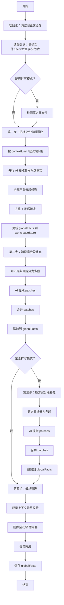
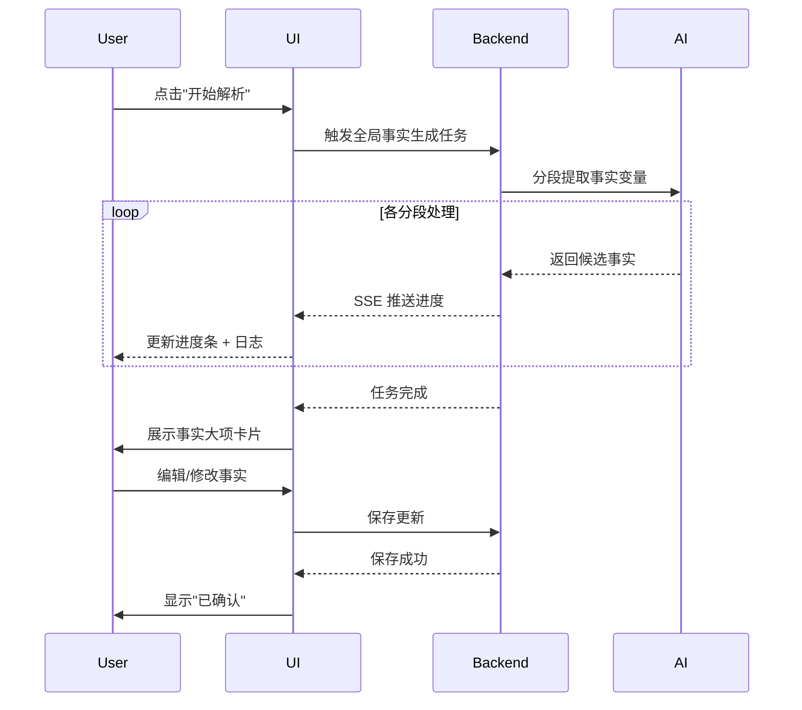

# 全局事实变量分析与提取

> **文档版本**：v1.0  
> **创建日期**：2026-08-14  
> **关联模块**：技术方案编写平台 — 全局事实变量管理  
> **技术栈**：TypeScript / React / Electron


## 一、什么是全局事实变量

全局事实变量是**技术方案正文中需要保持前后一致的确定性事实**，其核心目的是**避免各章节 AI 随机生成时出现人名、时间、型号等前后矛盾**。

### 1.1 包括哪些内容

| 类别                         | 示例                             |
| ---------------------------- | -------------------------------- |
| 项目人员角色、姓名、职责     | 项目经理：张伟，负责总体协调     |
| 工期、运维期、交货时间       | 建设工期：450 日历天             |
| 技术路线、设备型号、统一配置 | 塔吊：QTZ80（2台）               |
| 服务承诺、响应口径           | 承诺项目经理每月驻场不少于 22 天 |
| 实施做法、执行安排           | 采用 BIM 全过程管理              |

### 1.2 设计目标

```
┌─────────────────────────────────────────────────────────────┐
│  问题场景：各章节 AI 分别生成时                              │
│  第一章：项目经理叫 "张伟"                                   │
│  第三章：项目经理叫 "李强"  ← 前后矛盾！                    │
│  第五章：工期 360 天          ← 与招标文件 450 天不符！     │
└─────────────────────────────────────────────────────────────┘
                              ▼
┌─────────────────────────────────────────────────────────────┐
│  解决方案：全局事实变量中心化管理                            │
│  ✅ 所有章节引用同一事实源                                   │
│  ✅ 人工审核确认，一次修改全局生效                           │
│  ✅ 各章节 Prompt 强制注入事实约束                          │
└─────────────────────────────────────────────────────────────┘
```


## 二、数据结构定义

### 2.1 TypeScript 类型定义

来源：`client/src/features/technical-plan/types.ts`

```typescript
export interface GlobalFactGroupState {
  id: string;        // 唯一标识符（如 "project_team"）
  title: string;     // 大项标题（如 "项目角色变量"）
  content: string;   // 事实内容，Markdown bullet 列表格式
  updated_at?: string; // 最后更新时间
}
```

### 2.2 存储结构

全局事实整体存储于 `TechnicalPlanState`：

```typescript
globalFacts: GlobalFactGroupState[];
globalFactsTask?: BackgroundTaskState;
```

### 2.3 事实分组示例

```json
[
  {
    "id": "project_team",
    "title": "项目角色变量",
    "content": "- 项目经理：张伟，负责总体协调。\n- 技术负责人：李明，负责方案设计和联调验收。\n- 现场负责人：王强，负责现场实施协调。"
  },
  {
    "id": "schedule",
    "title": "工期安排",
    "content": "- 建设工期：450 日历天\n- 运维期：2 年（自竣工验收合格之日起计算）"
  },
  {
    "id": "tech_stack",
    "title": "技术路线与设备配置",
    "content": "- 塔吊型号：QTZ80（2台）\n- 混凝土强度：C30\n- BIM 管理平台：广联达 BIM5D"
  }
]
```


## 三、提取来源（数据源）

全局事实从 **4 个来源** 提取，按顺序处理，后序来源作为补充/补丁追加到前序结果之上。

```
┌─────────────────────────────────────────────────────────────────┐
│                    4 个提取来源（按顺序）                      │
├─────────────────────────────────────────────────────────────────┤
│  1️⃣  招标文件                  ← 核心来源（硬性要求）          │
│  2️⃣  Step02 关键解析结果        ← 项目信息/甲方信息/服务要求    │
│  3️⃣  技术方案目录              ← 上下文判断事实优先级          │
│  4️⃣  知识库条目（可选）        ← 以 patches 方式补充          │
└─────────────────────────────────────────────────────────────────┘
```

### 3.1 招标文件（核心来源）

- 分段读取招标文件 Markdown
- 按 `contextLengthLimit`（80% 预算）切分为多段
- 每段独立调用 AI 提取候选事实
- 分段候选合并去重、解决矛盾

### 3.2 Step02 关键解析结果

来源：`globalFactsTask.cjs`

```javascript
// 三个预设数据源
formatBidAnalysisFactForPrompt(storedPlan, 'projectInfo', '项目信息'),
formatBidAnalysisFactForPrompt(storedPlan, 'partAInfo', '甲方信息'),
formatBidAnalysisFactForPrompt(storedPlan, 'deliveryAndServiceRequirements', '交货和服务要求'),
```

### 3.3 技术方案目录

- 目录结构传入 AI 作为上下文
- 用于判断哪些事实对哪些章节最重要
- 每个章节的写作计划会记录用到的事实标题

### 3.4 知识库条目（可选）

- 用户在 Step03 中选择的参考知识库文档
- 以 **patches** 方式追加到已有事实变量
- **不覆盖**招标文件的硬性要求


## 四、提取标准（AI 必须遵循的规则）

### 4.1 核心判断标准

> ⚠️ **全局事实变量不是**：
> - 招标要求摘录
> - 评分规则摘要
> - 待办事项清单
> - 正文草稿
> - 分析过程/来源说明/风险提示

> ✅ **全局事实变量是**：
> - 技术方案正文中需要保持一致的**确定性方案事实**
> - 响应设定
> - 承诺口径
> - 执行安排

### 4.2 具体提取规则

| 规则             | 说明                                                         |
| ---------------- | ------------------------------------------------------------ |
| **用户资料优先** | 用户资料已给出明确事实值时，优先使用资料中的值               |
| **要求转事实**   | 资料只给出约束/要求时，转写为"本方案已采用/已具备/统一承诺"的事实表达 |
| **无值可补**     | 资料未给出具体值但对全文一致重要，且当前任务允许时，可模拟生成合理、稳定、不冲突的值 |
| **仅技术方案**   | 只关注技术方案部分，不涉及商务报价或资格材料                 |
| **必须有工期**   | 必须包含工期、运维期或交货时间中的至少一个变量               |

### 4.3 提取规则示例

| 资料内容（输入）         | 错误提取（❌）                      | 正确提取（✅）                        |
| ------------------------ | ---------------------------------- | ------------------------------------ |
| "项目经理要求一级建造师" | 招标要求项目经理持有一级建造师证书 | 项目经理：具备一级建造师执业资格     |
| "工期要求：不超过450天"  | 工期不能超过450天                  | 建设工期：450 日历天                 |
| "需提供2年质保"          | 需提供2年质保服务                  | 质保期：2 年（自竣工验收合格之日起） |
| "建议采用BIM管理"        | 建议采用BIM技术                    | 已采用 BIM 全过程管理平台            |


## 五、提取流程（分段流水线）

### 5.1 完整流程图



### 5.2 进度阶段明细

| 进度 | 阶段                     | 操作                                      |
| :--: | ------------------------ | ----------------------------------------- |
|  5%  | 开始                     | 初始化，清空旧正文缓存                    |
| 10%  | 读取数据                 | 加载招标文件、Step02 结果、目录、知识库   |
| 18%  | 原方案检测               | 扩写模式下检测原方案文件                  |
| 22%  | 第一步：招标文件分段提取 | 按 contextLimit 切分为多段，并行 AI 提取  |
| 34%  | 分段提取中               | 进度提示各分段处理情况                    |
| 44%  | 分段候选合并             | 合并所有招标文件分段的候选事实            |
| 48%  | 应用招标文件结果         | 更新 globalFacts 到 workspaceStore        |
| 52%  | 第二步：知识库分段补充   | 知识库条目拆分为多段，以 patches 形式补充 |
| 58%  | 补充分段中               | 进度提示各分段处理情况                    |
| 64%  | 补丁合并                 | 合并知识库补充 patches                    |
| 66%  | 应用知识库结果           | 更新 globalFacts                          |
| 70%  | 第三步：原方案分段补充   | 扩写模式下，原方案分段拆分为多段          |
| 77%  | 补充分段中               | 进度提示各分段处理情况                    |
| 84%  | 补丁合并                 | 合并原方案补充 patches                    |
| 86%  | 应用原方案结果           | 更新 globalFacts                          |
| 90%  | 第四步：最终整理         | 轻量上下文最终校验，删除空泛/矛盾内容     |
| 92%  | 合并完成                 | 输出最终 groups                           |
| 100% | 任务完成                 | 保存 globalFacts，任务状态 success        |


## 六、JSON 格式规范

### 6.1 提取结果格式

```json
{
  "groups": [
    {
      "id": "project_team",
      "title": "项目角色变量",
      "content": "- 项目经理：张伟，负责总体协调。\n- 技术负责人：李明，负责方案设计和联调验收。"
    },
    {
      "id": "schedule",
      "title": "工期安排",
      "content": "- 建设工期：450 日历天\n- 运维期：2 年（自竣工验收合格之日起计算）"
    }
  ]
}
```

### 6.2 补充 Patches 格式

```json
{
  "patches": [
    {
      "target_group_id": "project_team",
      "new_group_id": "project_team",
      "title": "项目角色变量",
      "mode": "append",
      "content": "- 现场负责人：王强，负责现场实施协调。"
    }
  ]
}
```

**mode 取值说明**：

| mode      | 说明                          |
| --------- | ----------------------------- |
| `append`  | 追加到目标 group 末尾（默认） |
| `prepend` | 前置到目标 group 开头         |
| `replace` | 完全替换目标 group 内容       |


## 七、使用方式（正文生成中的注入）

### 7.1 注入位置

全局事实变量在 **正文生成阶段（STEP05）** 被使用，作为稳定上下文注入到每个章节的 Prompt 中。

来源：`contentGenerationTask.cjs`

```javascript
// 格式化为 prompt 注入正文生成
function formatGlobalFactsForPrompt(globalFacts) {
  // 遍历所有 groups，格式化为文本
  let result = '';
  for (const group of globalFacts) {
    result += `### ${group.title}\n${group.content}\n\n`;
  }
  return result;
}

// 注入到正文生成 prompt
messages.push({
  role: 'user',
  content: `全局事实变量（正文涉及时优先使用这些变量值，避免各章节随机变化）：\n${content}`,
});
```

### 7.2 章节事实关联

每个章节的写作计划中记录该章节用到的事实变量标题：

```json
{
  "facts": {
    "titles": ["项目角色变量", "工期安排"]
  }
}
```

### 7.3 Prompt 注入示例

```markdown
## 全局事实变量（正文涉及时优先使用这些变量值，避免各章节随机变化）

### 项目角色变量
- 项目经理：张伟，负责总体协调。
- 技术负责人：李明，负责方案设计和联调验收。
- 现场负责人：王强，负责现场实施协调。

### 工期安排
- 建设工期：450 日历天
- 运维期：2 年（自竣工验收合格之日起计算）

### 技术路线与设备配置
- 塔吊型号：QTZ80（2台）
- 混凝土强度：C30
- BIM 管理平台：广联达 BIM5D
```


## 八、UI 交互能力

来源：`GlobalFactsPage.tsx`

### 8.1 操作列表

| 操作          | 说明                         |
| ------------- | ---------------------------- |
| 开始解析      | 触发后台生成任务             |
| 重新解析      | 重置后重新生成               |
| 新增大项      | 手动添加新的事实变量组       |
| 删除大项      | 删除选中的事实变量组         |
| 编辑标题/内容 | Markdown 编辑器实时编辑      |
| 保存          | 保存后自动清空旧正文生成缓存 |
| 复制          | 复制当前事实内容到剪贴板     |
| 进度展示      | 实时显示 0-100% 进度条和日志 |

### 8.2 页面交互流程




## 九、数据流向总结

```
┌─────────────────────────────────────────────────────────────────┐
│                        数据流向总览                            │
├─────────────────────────────────────────────────────────────────┤
│                                                                 │
│  招标文件 Markdown  ──────────────────────────┐                │
│  Step02 关键解析结果（项目信息/甲方信息/要求）─┤                │
│  技术方案目录      ──────────────────────────┼──→ AI 分段提取   │
│  知识库条目（可选）────────────────────────────┘    │           │
│                                                      │           │
│                                                      ▼           │
│                                           合并 + 去重 + 矛盾解决 │
│                                                      │           │
│                                                      ▼           │
│                                    workspaceStore.globalFacts    │
│                                                      │           │
│                    ┌─────────────────────────────────┼───────────┤
│                    │                                 │           │
│                    ▼                                 ▼           │
│           UI 编辑（GlobalFactsPage）        正文生成 Prompt 注入 │
│           - 查看/编辑/增删                   - 各章节强制引用   │
│           - 保存/重新解析                   - 保持一致口径     │
│                                                                 │
└─────────────────────────────────────────────────────────────────┘
```


## 十、总结

全局事实变量模块的设计体现了以下核心思路：

1. **集中管理、分散使用**：事实变量在全局统一提取和维护，在各章节生成时分别注入
2. **多源融合、分层覆盖**：招标文件 → Step02 → 目录 → 知识库，后序来源作为补丁追加
3. **人工审核、机器执行**：AI 负责提取候选，人工负责确认和编辑，确保准确性
4. **写入 Prompt、强制遵守**：正文生成时事实变量作为强约束注入，避免 AI 随机编造

这套机制的最终目的是：**让 AI 生成的每一章、每一段，在人名、时间、型号、口径等关键事实上保持前后一致，杜绝因分段生成导致的自相矛盾。**